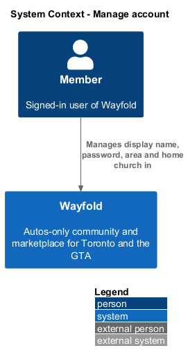
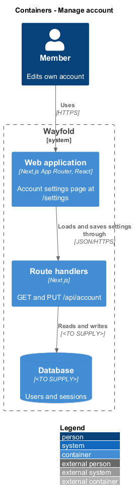
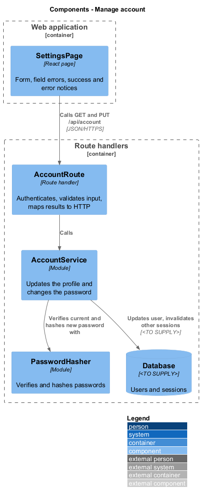
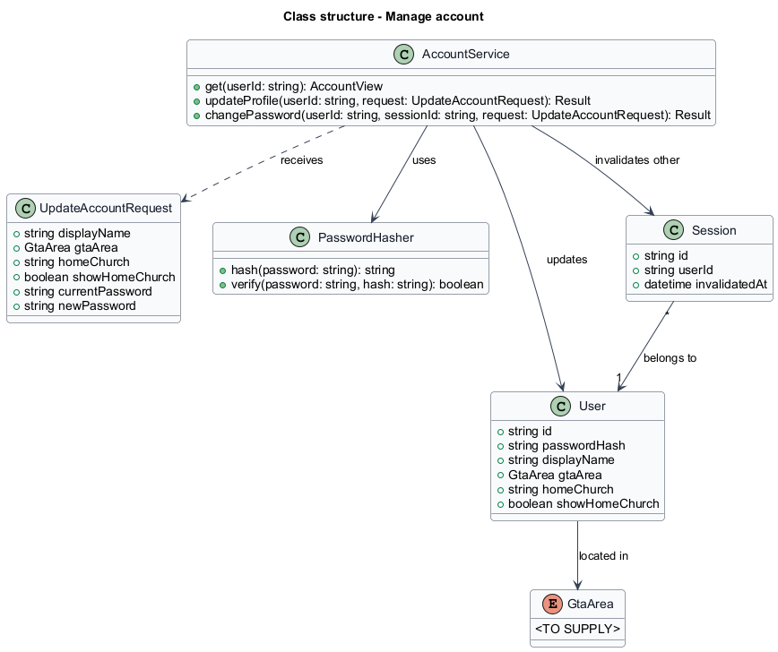
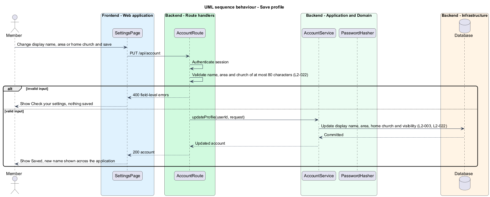
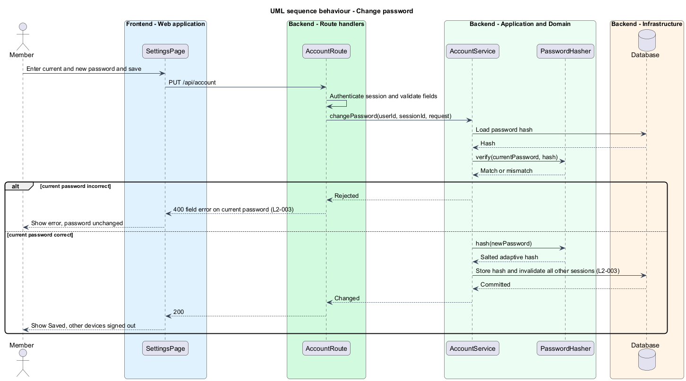

# Manage account

## Overview

Wayfold is a responsive web application that is a micro-community for people in Toronto and the Greater Toronto Area who buy, sell and look after cars. Anyone in the GTA can join, and members may optionally show a home church as a trust signal. A *member* is a person with a registered account. A *display name* is the name other members see on the member's profile, listings and recommendations. A *home church* is an optional free-text name of the church a member attends, shown only as a trust signal. A *session* is a server-side record of one signed-in browser.

This feature lets a signed-in member change the display name and the password, choose a GTA area, and optionally enter a home church of at most 80 characters with a toggle that controls whether other signed-in members see it. It sits in the `accounts` subsystem after sign-in and uses the `User` and `Session` records that registration and sign-in create. Wayfold has no church content or church administration. The home church is one text field and one visibility flag.

The feature protects two concerns. A password change requires the current password and signs out every other session. The home church is never returned to a signed-out visitor.

## Description

The feature is a vertical slice from the settings page to the database. The route is `/settings`.

- **`SettingsPage`** — React page in the Next.js App Router. It renders one form with display name, GTA area, home church, the checkbox Show my home church to signed-in members, current password and new password, and one Save settings button. It shows the states of the mock `settings`: default; loading, while the account loads; submitting, with the form inert; invalid, with the Check your settings notice and field messages such as Use 80 characters or fewer; success, with the Saved notice; and error, with Could not load this page and a Try again button.
- **`AccountRoute`** — route handler for `GET /api/account` and `PUT /api/account`. It authenticates the session, validates the fields, calls `AccountService`, and maps results to `200`, `400` or `401`. The split of the single form into profile and password operations happens in the service.
- **`AccountService`** — module holding the application logic. `updateProfile` stores the display name, area, home church and visibility. `changePassword` verifies the current password, hashes the new one, stores it, and invalidates every `Session` of the user except the current one.
- **`PasswordHasher`** — module that hashes and verifies passwords. The algorithm is `<TO SUPPLY>`.
- **`User`** — record extended with `gtaArea`, `homeChurch` (at most 80 characters, optional) and `showHomeChurch` (default off).
- **`GtaArea`** — the defined list of Toronto and GTA municipalities (`L2-014`). The full list is `<TO SUPPLY>`.

The field `showHomeChurch` is the input to the rules that hide the church from signed-out visitors and from other members. Those rules are enforced where member profiles are served, outside this feature. The rule for the length of the new password is `<TO SUPPLY>`; registration uses at least 12 characters. The database technology, the auth library and the session store are `<TO SUPPLY>`.

## Requirements

| L2 ID | Refines (L1) | Requirement |
|-------|--------------|-------------|
| `L2-003` | `L1-001` | A signed-in user shall be able to change their display name and password. |
| `L2-022` | `L1-002` | A member shall optionally enter a home church of up to 80 characters and choose whether signed-in members can see it. |

Acceptance criteria from the specification for `L2-003`: a saved display name is shown across the application. A password change with the correct current password succeeds and invalidates other sessions. An incorrect current password is rejected.

Acceptance criteria from the specification for `L2-022`: a church name of at most 80 characters with Show my home church enabled appears on the profile to signed-in members. A member who disables it is shown without the church. A church name longer than 80 characters shows a field error and is not saved. A signed-out visitor never receives the church name.

## Diagrams

### System context

A signed-in member manages the account in Wayfold. No external system takes part.

### Containers

The browser loads the settings page, which calls the account route handlers. The handlers read and write the database.

### Components

`AccountRoute` delegates to `AccountService`, which uses `PasswordHasher` and persists through the database.

### Class structure

`AccountService` receives an `UpdateAccountRequest`, updates the `User`, and invalidates the other `Session` records of that user on a password change.

### Behaviour - save profile

The route rejects invalid input, including a home church over 80 characters, with field errors and saves nothing. Otherwise the service stores the profile and the page shows Saved (`L2-003`, `L2-022`).

### Behaviour - change password

The service verifies the current password. A mismatch is rejected and the password stays. A match stores the new hash and invalidates every other session (`L2-003`).

