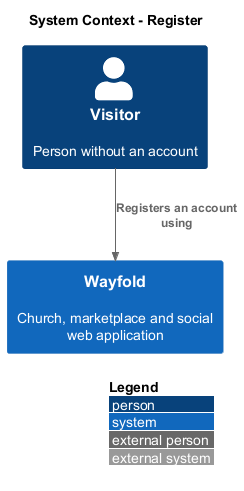
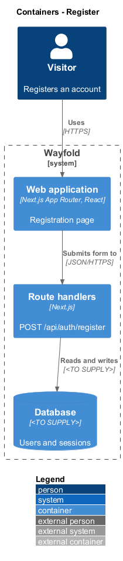
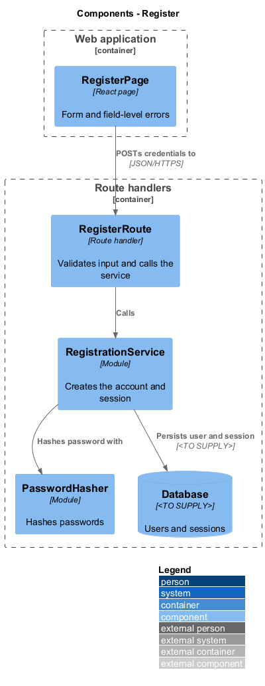
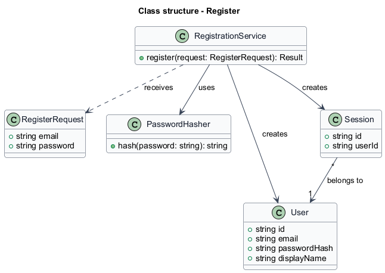
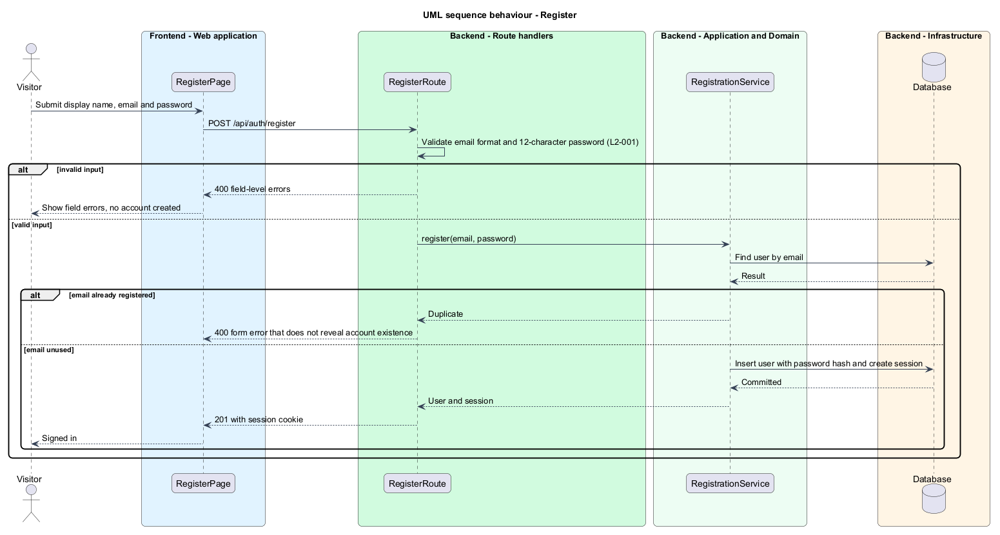

# Register

## Overview

Wayfold is a responsive web application that is a micro-community for people in Toronto and the Greater Toronto Area who buy, sell and look after cars. Anyone in the GTA can join, and members may optionally show a home church as a trust signal. A *visitor* is a person without an account. An *account* is a stored identity, made of a display name, an email address and a password, that every other Wayfold capability depends on.

This feature lets a visitor create an account with a display name, an email address and a password and be signed in immediately. It sits first in the `accounts` subsystem: sign-in, sign-out, and account management build on the user and session records it creates.

The feature protects two concerns. Input errors appear as field-level messages. A duplicate email produces a form error that does not reveal whether the account exists.

## Description

The feature is a vertical slice from the registration page to the database.

- **`RegisterPage`** — React page in the Next.js App Router. It renders the display name, email and password form and shows field-level and form-level errors.
- **`RegisterRoute`** — Next.js route handler for `POST /api/auth/register`. It validates the display name, the email format and the password length, then calls the service.
- **`RegistrationService`** — module holding the application logic. It checks for an existing email, hashes the password, creates the `User` and a `Session`, and commits them together.
- **`PasswordHasher`** — module that hashes passwords. The algorithm is `<TO SUPPLY>`.
- **`User`** — record with `id`, `email`, `passwordHash`, and `displayName`.
- **`Session`** — record with `id` and `userId`, delivered to the browser as a cookie. The session store is `<TO SUPPLY>`.

The database technology and the auth library are `<TO SUPPLY>`.

## Requirements

| L2 ID | Refines (L1) | Requirement |
|-------|--------------|-------------|
| `L2-001` | `L1-001` | A visitor shall register with a display name, an email address and a password. |

Acceptance criteria from the specification: a display name, a valid unused email and a password of at least 12 characters creates an account and signs the user in. A duplicate email is rejected without revealing the account's existence beyond the form error. A missing display name, an invalid email or a password under 12 characters produces field-level errors and creates no account.

## Diagrams

### System context

A visitor registers an account through Wayfold. No external system takes part.

### Containers

The browser loads the web application, which posts to the route handlers. The handlers persist to the database.

### Components

`RegisterRoute` validates and delegates to `RegistrationService`, which uses `PasswordHasher` and persists through the database.

### Class structure

`RegistrationService` receives a `RegisterRequest`, and creates a `User` and a `Session` that belongs to it.

### Behaviour — register

The route rejects invalid input with field errors. The service rejects a duplicate email with a non-revealing form error. Otherwise the service creates the user and session and the page shows the visitor signed in (`L2-001`).

