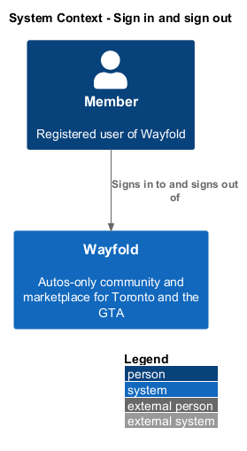
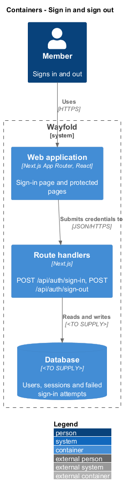
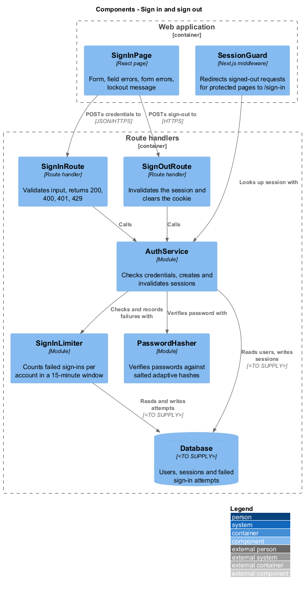
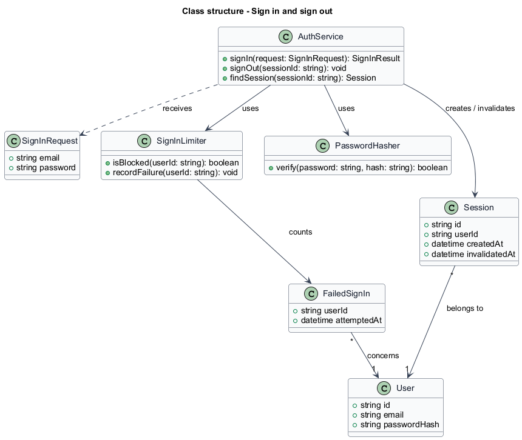
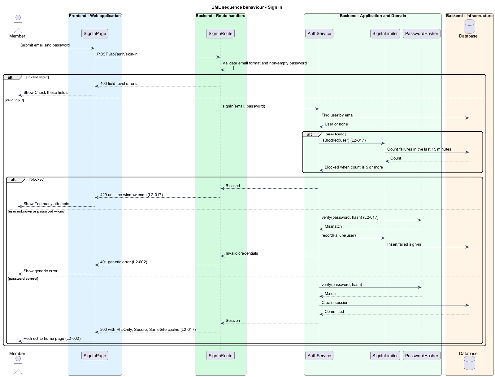
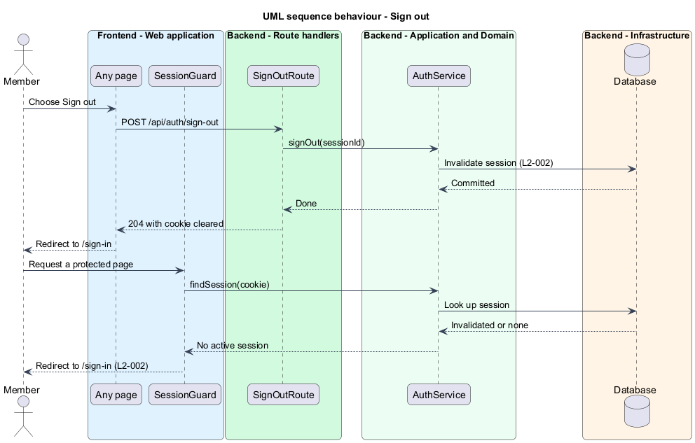

# Sign in and sign out

## Overview

Wayfold is a responsive web application that is a micro-community for people in Toronto and the Greater Toronto Area who buy, sell and look after cars. Anyone in the GTA can join, and members may optionally show a home church as a trust signal. A *member* is a person with a registered account. A *session* is a server-side record of one signed-in browser, identified by a cookie. A *lockout* is a temporary block on sign-in attempts for one account after repeated failures.

This feature lets a member sign in with an email address and a password, reach the home page, and sign out at any time. It protects credentials: passwords are stored only as salted adaptive hashes, repeated failures block the account for the rest of a 15-minute window, and session cookies carry the `HttpOnly`, `Secure` and `SameSite` attributes. It sits in the `accounts` subsystem after registration and before account management, and uses the `User` records that registration creates.

The feature treats three concerns separately. Input errors appear as field-level messages. A wrong email or a wrong password produces one generic message that does not reveal which was wrong. A blocked account produces a distinct lockout message.

## Description

The feature is a vertical slice from the sign-in page to the database. The route is `/sign-in`.

- **`SignInPage`** — React page in the Next.js App Router. It renders the email and password form and shows the states of the mock `sign-in`: default; loading, while the page renders and checks for an existing session; submitting, with the button reading Signing in and the form inert; invalid, with field messages under Check these fields; error, with Something went wrong and Try again in a moment, for a server or network failure; and locked, with Too many attempts and Wait 15 minutes before trying again. A link leads to Create an account.
- **`SignInRoute`** — route handler for `POST /api/auth/sign-in`. It validates the email format and a non-empty password, calls `AuthService`, and maps the result to `200`, `400`, `401` or `429`.
- **`SignOutRoute`** — route handler for `POST /api/auth/sign-out`. It calls `AuthService` and clears the session cookie.
- **`AuthService`** — module holding the application logic. It finds the user, asks `SignInLimiter` whether the account is blocked, verifies the password, creates the `Session`, and invalidates a `Session` on sign-out.
- **`SignInLimiter`** — module that counts `FailedSignIn` records per account. It blocks the sixth attempt when 5 failures fall inside the last 15 minutes. Whether a successful sign-in clears the count is `<TO SUPPLY>`.
- **`PasswordHasher`** — module that verifies a password against a stored hash. The hash is salted and adaptive. The algorithm is `<TO SUPPLY>`.
- **`SessionGuard`** — check on protected pages. It looks up the session from the cookie and redirects a request without an active session to `/sign-in`. The mechanism (middleware or per-page check) is `<TO SUPPLY>`.
- **`User`**, **`Session`**, **`FailedSignIn`** — records. `Session` holds `id`, `userId`, `createdAt` and `invalidatedAt`. `FailedSignIn` holds `userId` and `attemptedAt`.

A failed attempt for an email that matches no account returns the same `401` as a wrong password. The way such attempts are counted, since no account exists to count against, is `<TO SUPPLY>`. The database technology, the auth library and the session store are `<TO SUPPLY>`. Session lifetime is `<TO SUPPLY>`.

## Requirements

| L2 ID | Refines (L1) | Requirement |
|-------|--------------|-------------|
| `L2-002` | `L1-001` | A registered user shall sign in with email and password and sign out at any time. |
| `L2-017` | `L1-008` | Credentials and sessions shall be protected. |

Acceptance criteria from the specification for `L2-002`: correct credentials create a session and the member reaches the home page. Incorrect credentials fail with a generic error message. Signing out invalidates the session, and protected pages redirect to sign-in.

Acceptance criteria from the specification for `L2-017`: stored passwords are only salted adaptive hashes. A sixth sign-in attempt after 5 failures for an account within 15 minutes is blocked with HTTP 429 until the window ends. Every request uses HTTPS, and session cookies are HttpOnly, Secure and SameSite.

## Diagrams

### System context

A member signs in to and out of Wayfold. No external system takes part.

### Containers

The browser loads the web application, which posts to the route handlers. The handlers read and write the database.

### Components

`SignInRoute` and `SignOutRoute` delegate to `AuthService`. `AuthService` uses `SignInLimiter` and `PasswordHasher`. `SessionGuard` reads the session through `AuthService`.

### Class structure

`AuthService` receives a `SignInRequest` and creates or invalidates a `Session`. `SignInLimiter` counts the `FailedSignIn` records of a `User`.

### Behaviour - sign in

The route rejects invalid input with field errors. The service checks the lockout before the password, so a blocked account receives `429` whatever the password (`L2-017`). A wrong password records a failure and returns a generic `401` (`L2-002`). A correct password creates a session and sets the cookie.

### Behaviour - sign out

The route invalidates the session and clears the cookie. A later request for a protected page finds no active session and redirects to `/sign-in` (`L2-002`).

