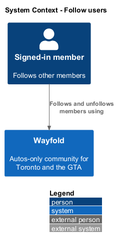
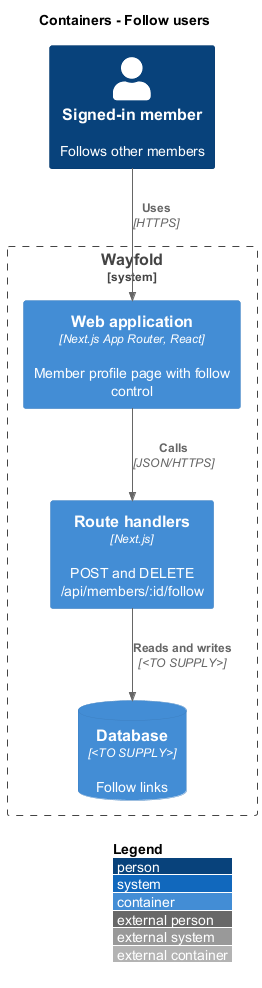
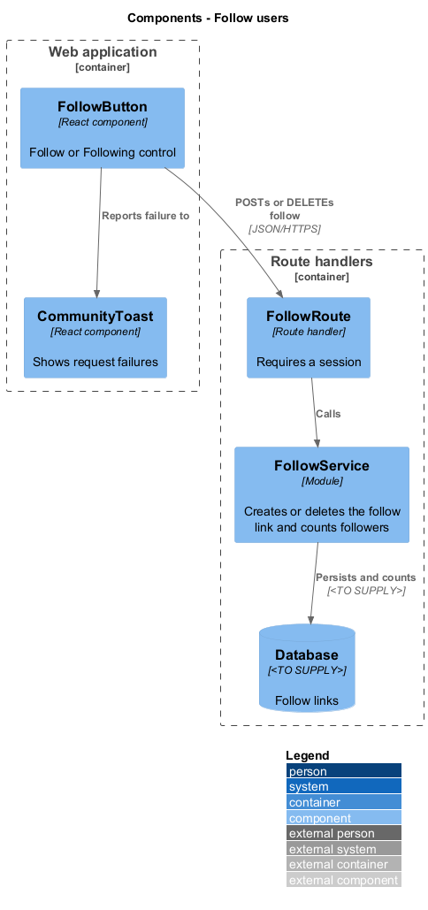
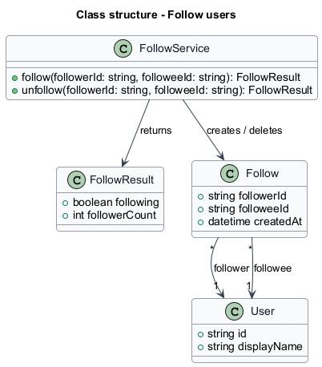
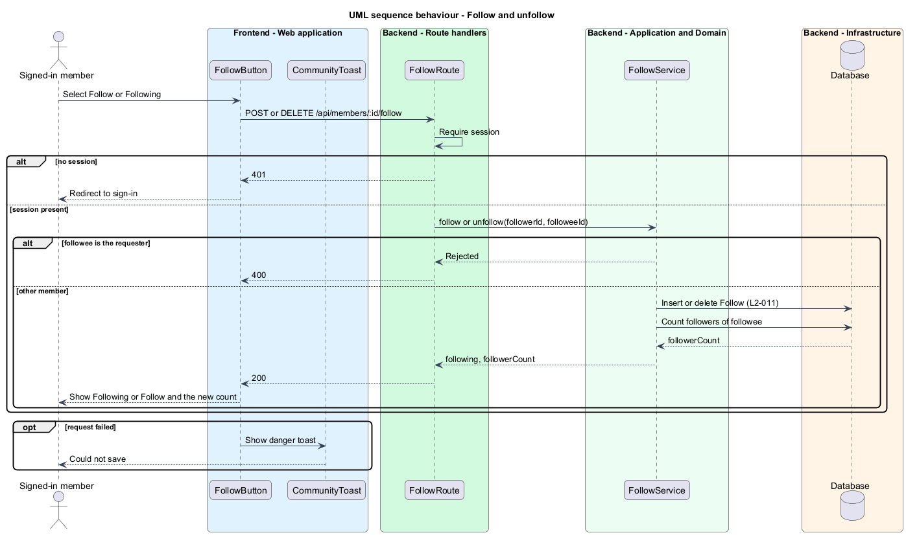

# Follow users

## Overview

Wayfold is a responsive web application that is a micro-community for people in Toronto and the Greater Toronto Area (GTA) who buy, sell and look after cars. A *member* is a person with an account. A *follow* is a one-way link from a member to another member that adds the followed member's posts to the follower's feed.

This feature lets a signed-in member follow and unfollow another member from that member's profile. The profile shows the state as a Follow or Following control and shows a follower count. A member's own profile offers no follow action.

The feature sits in the `community` subsystem. The `posts-and-feed` feature reads the follow links to decide which posts appear in a feed. The `view-member-profile` feature hosts the follow control.

## Description

The feature is a vertical slice from the profile follow control to the database.

- **`FollowButton`** - React component on `/members/:id`. It shows "Follow Name" or "Following", sets `aria-pressed`, and is not rendered on the member's own profile. It disables itself while a request is in flight.
- **`FollowRoute`** - Next.js route handler for `POST /api/members/:id/follow` and `DELETE /api/members/:id/follow`. It requires a session and calls `FollowService`.
- **`FollowService`** - module holding the application logic. It rejects a follow of oneself, creates or deletes the `Follow` record, and returns the new follower count.
- **`Follow`** - record with `followerId`, `followeeId` and `createdAt`. The pair of ids is unique, so a repeated follow does not create a second record.
- **`CommunityToast`** - React component that shows a transient message. The mock shows an info toast "Priya Nair started following you." and a danger toast "Could not save - Please try again." for a failed request.

The follower count shown on the profile is the number of `Follow` records whose `followeeId` is the member. The mock header reads "Following 32 members", which the mock does not distinguish from the follower count (see the design notes). Whether a followed member receives the info toast is `<TO SUPPLY>`; no L2 requirement covers a follow notification, and the delivery mechanism is `<TO SUPPLY>`.

The database technology and the auth library are `<TO SUPPLY>`.

## Requirements

| L2 ID | Refines (L1) | Requirement |
|-------|--------------|-------------|
| `L2-011` | `L1-004` | A signed-in user shall follow and unfollow other users. |

Acceptance criteria from the specification: a signed-in user who follows from another member's profile sees "Following" and the follower count increases by 1. Unfollowing decreases the count by 1. A user's own profile offers no follow action.

The server enforces the third criterion as well: `FollowService` rejects a follow request whose target is the requester with 400.

## Diagrams

### System context

A signed-in member follows or unfollows another member through Wayfold. No external system takes part.

### Containers

The profile page in the web application calls the follow route handler, which persists the follow link.

### Components

`FollowButton` calls `FollowRoute`, which delegates to `FollowService`. The service writes `Follow` records and counts them.

### Class structure

`FollowService` creates and deletes `Follow` records. Each `Follow` links one follower to one followee, both `User` records.

### Behaviour - follow and unfollow

The route requires a session and rejects a self-follow. A follow adds one record and the count increases by 1. An unfollow removes it and the count decreases by 1 (`L2-011`). A failed request shows the danger toast and leaves the control unchanged.

