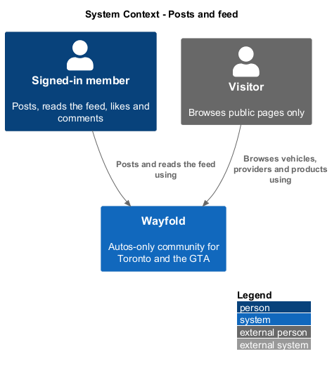
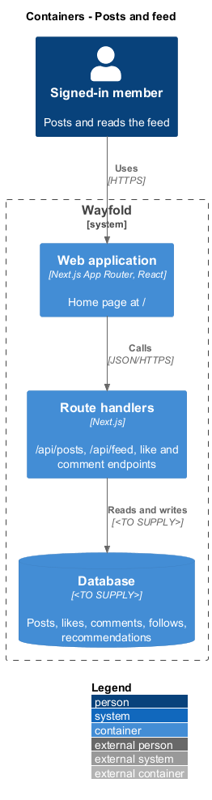
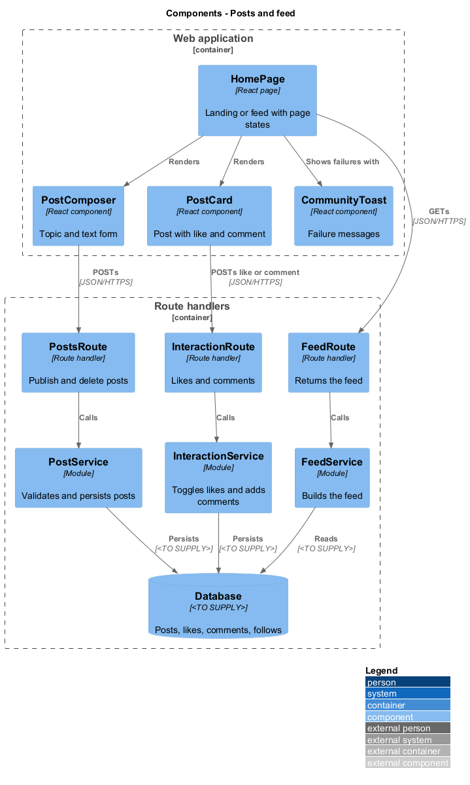
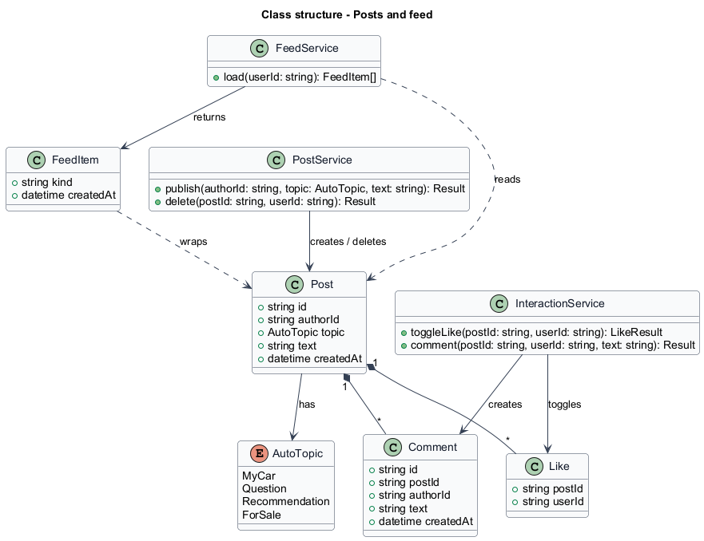
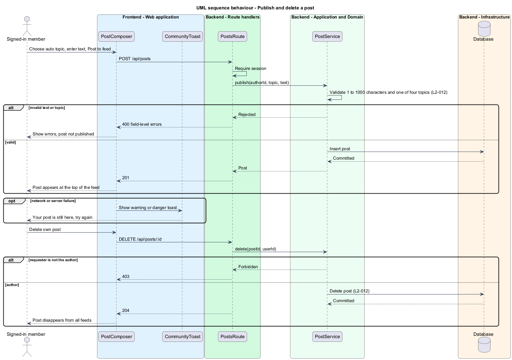
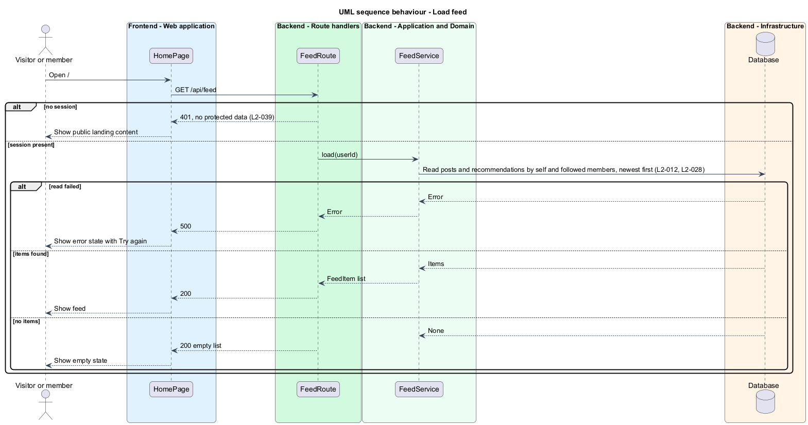
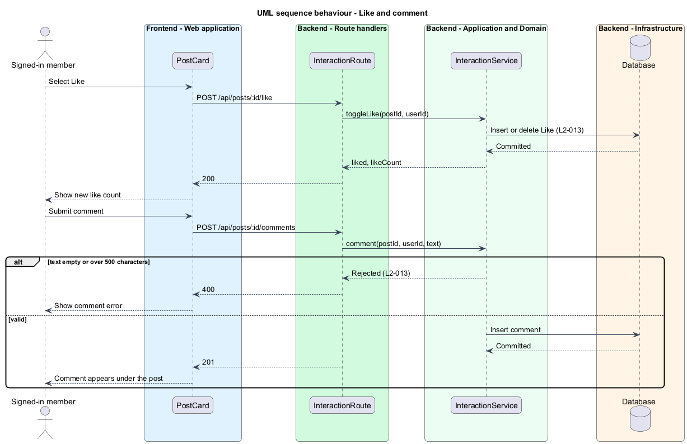

# Posts and feed

## Overview

Wayfold is a responsive web application that is a micro-community for people in Toronto and the Greater Toronto Area (GTA) who buy, sell and look after cars. A *post* is a short text message that a member publishes to the community. An *auto topic* is one of four labels on a post: My car, Question, Recommendation or For sale. A *feed* is the list of posts from the members that a member follows, and from the member, shown newest first.

This feature lets a signed-in member publish a post with an auto topic, delete their own post, read the feed, and like and comment on posts. It also states which of these parts a signed-out visitor can reach: the feed requires sign-in, while vehicles, providers and products stay public.

The feature sits in the `community` subsystem. It reads the follow links that the `follow-users` feature creates and shows the recommendations that the `recommend` feature creates.

## Description

The feature is a vertical slice from the home page to the database. The home page at `/` serves two audiences. A visitor sees the public landing content. A signed-in member sees the feed.

- **`HomePage`** - React page at `/`. It chooses between the landing content and the feed according to the session, and shows the feed loading, empty and error states of the mocks. The empty state reads "Nothing here yet" and the error state reads "Could not load this page" with a Try again action.
- **`PostComposer`** - React component with the auto topic choice, a text area and a Post to feed action. It shows field-level errors for empty text, text over 1000 characters, or a missing topic.
- **`FeedList`** - React component that renders feed items in the order the API returns.
- **`PostCard`** - React component that shows the author, topic, area, church tag, text, like count and comment count. It renders text as escaped text and offers Delete to the author only.
- **`LikeButton`** and **`CommentForm`** - React components for liking and commenting. The comment form states "up to 500 characters".
- **`PostsRoute`** - route handler for `POST /api/posts` and `DELETE /api/posts/:id`. It requires a session.
- **`FeedRoute`** - route handler for `GET /api/feed`. It requires a session and answers 401 to a visitor.
- **`InteractionRoute`** - route handler for `POST /api/posts/:id/like` (toggle) and `POST /api/posts/:id/comments`.
- **`PostService`** - module that validates a post, checks authorship on delete, and persists posts.
- **`FeedService`** - module that returns posts authored by the member or by followed members, newest first, merged with recommendations from the same members (`L2-028`).
- **`InteractionService`** - module that toggles a `Like` and creates a `Comment`.
- **`Post`** - record with `id`, `authorId`, `topic`, `text` and `createdAt`.
- **`Like`** - record with `postId` and `userId`; the pair is unique.
- **`Comment`** - record with `id`, `postId`, `authorId`, `text` and `createdAt`.
- **`CommunityToast`** - React component for the info, success, warning and danger messages. The warning toast "Connection interrupted - Your post is still here. Try again." appears when the network fails. The danger toast "Could not save - Please try again." appears when the server rejects a save.

> **Deferred** until marketplace and recommendations exist (see AGENTS.md): recommendations merged into the feed (`L2-028`), and the For sale listing link.

Page size and pagination of the feed are `<TO SUPPLY>`. Whether a For sale post links to a listing, as the mock shows with "See Priya's listing", is `<TO SUPPLY>`. The database technology and the auth library are `<TO SUPPLY>`.

## Requirements

| L2 ID | Refines (L1) | Requirement |
|-------|--------------|-------------|
| `L2-012` | `L1-004` | A signed-in member shall publish auto-related text posts with an auto topic of My car, Question, Recommendation or For sale and see a feed of posts from members they follow and themselves. |
| `L2-013` | `L1-004` | A signed-in user shall like and comment on posts. |
| `L2-039` | `L1-004` | Signed-out visitors shall browse vehicles, providers and products. The feed and member profiles shall require sign-in, and church affiliation shall never be returned to visitors. |

Acceptance criteria from the specification: a post of 1 to 1000 characters appears at the top of the author's feed. An empty or over-length post is rejected. A followed member's post appears in reverse chronological order. The author can delete a post and it disappears from all feeds. Post text that contains HTML or script is rendered as escaped text. A post without one of the four auto topics is rejected (`L2-012`). Liking a post increases the like count by 1 and liking again removes the like. A comment of 1 to 500 characters appears under the post, and an over-length comment is rejected (`L2-013`). A visitor who opens vehicle, provider or product pages sees public content without church affiliation. A visitor who requests the feed or a member profile is redirected to sign-in and no protected data is returned (`L2-039`).

The routes apply the same validation as the composer. Escaping happens at render time, because React escapes text by default and the service stores the text unchanged.

## Diagrams

### System context

A signed-in member posts, reads the feed, likes and comments. A visitor reaches public pages only. No external system takes part.

### Containers

The home page in the web application calls the post, feed and interaction route handlers, which persist to the database.

### Components

The page components call three route handlers. `PostService`, `FeedService` and `InteractionService` hold the logic.

### Class structure

A `Post` has one author, zero or more `Like` records and zero or more `Comment` records. `FeedService` returns `FeedItem` values built from posts and recommendations.

### Behaviour - publish and delete a post

The route validates length and topic (`L2-012`). Only the author deletes a post. A failure shows a toast and keeps the text.

### Behaviour - load feed

A visitor receives a 401 and the page shows the landing content (`L2-039`). A member receives followed and own posts newest first (`L2-012`). A failed load shows the error state.

### Behaviour - like and comment

A like toggles. A comment of 1 to 500 characters is added under the post (`L2-013`).

