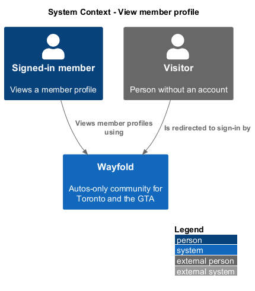
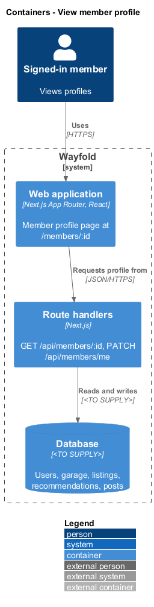
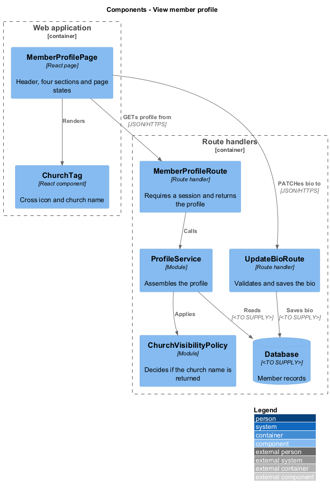
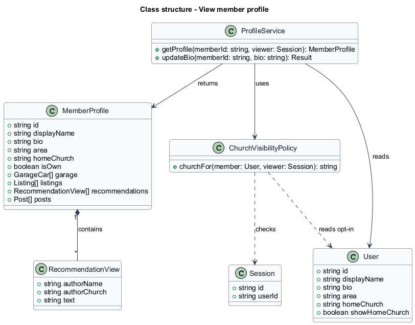
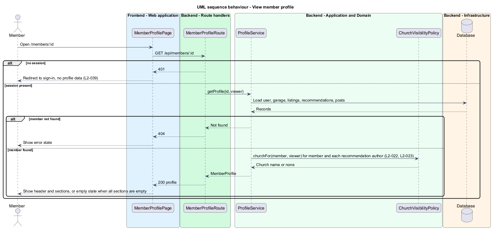
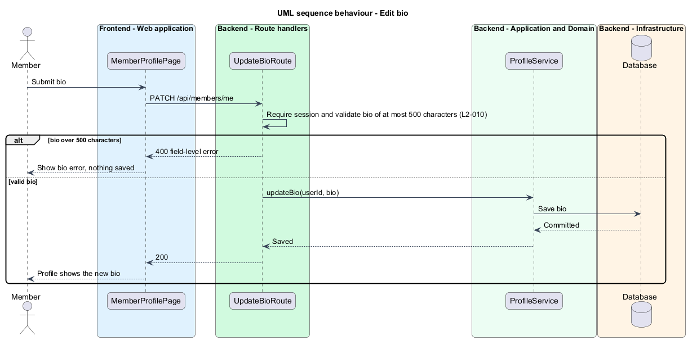

# View member profile

## Overview

Wayfold is a responsive web application that is a micro-community for people in Toronto and the Greater Toronto Area (GTA) who buy, sell and look after cars. Anyone in the GTA can join. A *member* is a person with an account. A *member profile* is a page that presents one member to other signed-in members.

This feature shows a member profile at `/members/:id`. The page presents the display name, an optional bio, the GTA area, and four sections: garage, for sale, recommendations and posts. It also lets a member edit their own bio. A *home church tag* is an optional church name that a member chooses to show as a trust signal. Wayfold has no church content or church administration, so the tag is a single line of text beside a cross icon.

The feature sits in the `community` subsystem. It reads data that the `follow-users`, `posts-and-feed`, `manage-garage` and `recommend` features create, and it composes them into one page. Signed-out visitors cannot open a profile, and the church name is never returned to them.

## Description

The feature is a vertical slice from the profile page to the database.

- **`MemberProfilePage`** - React page at `/members/:id`. It renders the header (name, area, follower information, church tag, bio) and the Garage, For sale, Recommendations and Posts sections. It shows the loading, empty and error states of the mocks. For the signed-in owner it renders the Edit profile and Add a car actions instead of the Follow action.
- **`ProfileHeader`** - React component that shows the display name, GTA area, church tag, bio and the follow control. The follow control is described in the `follow-users` design.
- **`ChurchTag`** - React component that renders a cross icon and the church name. It renders nothing when the response has no church field.
- **`ProfileSection`** - React component that renders one of the four sections and its empty message.
- **`MemberProfileRoute`** - Next.js route handler for `GET /api/members/:id`. It requires a session, loads the profile through `ProfileService`, and answers 401 for a visitor.
- **`UpdateBioRoute`** - Next.js route handler for `PATCH /api/members/me`. It rejects a bio of more than 500 characters with a field-level error.
- **`ProfileService`** - module holding the application logic. It assembles the profile from the user, garage, listing, recommendation and post records and applies `ChurchVisibilityPolicy`.
- **`ChurchVisibilityPolicy`** - module that returns the church name only when the viewer is signed in and the member has enabled Show my home church. It applies to the profile header, to the author of each recommendation and to the seller panel of a listing (`L2-023`).
- **`User`** - record with `id`, `displayName`, `bio`, `area`, `homeChurch` and `showHomeChurch`. The church fields are written by the settings feature (`L2-022`).
- **`GarageCar`**, **`Listing`**, **`Recommendation`**, **`Post`** - records owned by sibling features and read by this feature.

> **Deferred** until marketplace and recommendations exist (see AGENTS.md): the For sale and Recommendations section content, which show their empty states meanwhile.

The mocks show eight states for `/members/:id`: default (garage section), for-sale, recommendations, posts, own, loading, empty and error. The default, for-sale, recommendations and posts states differ only by the active section. The error state shows "Could not load this page" with a Try again action. The mocks show no editor for the bio, so the bio editing screen is `<TO SUPPLY>`.

Page size and ordering of each section list are `<TO SUPPLY>`. The database technology and the auth library are `<TO SUPPLY>`.

## Requirements

| L2 ID | Refines (L1) | Requirement |
|-------|--------------|-------------|
| `L2-010` | `L1-004` | Each member shall have a profile page showing display name, optional bio, GTA area, garage, active listings, recommendations and posts. |
| `L2-022` | `L1-002` | A member shall optionally enter a home church of up to 80 characters and choose whether signed-in members can see it. |
| `L2-023` | `L1-002` | An opted-in church affiliation shall appear with a private seller, recommendation author or provider owner only to signed-in members. |

Acceptance criteria from the specification: a signed-in user who edits a bio of at most 500 characters sees it on the profile, and a bio over 500 characters is rejected (`L2-010`). Another member's profile shows name, bio, GTA area, garage, listings, recommendations and posts in their sections (`L2-010`). A member who disables Show my home church has no church on the profile, and a signed-out visitor never receives the church name (`L2-022`). This design covers only the display of the church (`L2-022` criteria 1, 2 and 4); saving the church name belongs to the settings feature. For `L2-023`, this design covers the private seller and the recommendation author on the profile. The provider owner statement belongs to the provider profile design.

Access rule from `L2-039`: a signed-out visitor who requests a member profile is redirected to sign-in and no profile data is returned. The `posts-and-feed` design owns that requirement; this feature applies it in `MemberProfileRoute`.

## Diagrams

### System context

A signed-in member views another member's profile, or their own, through Wayfold. A visitor is turned away to sign-in. No external system takes part.

### Containers

The browser loads the web application, which calls the route handlers. The handlers read and write the database.

### Components

`MemberProfilePage` calls `MemberProfileRoute`, which delegates to `ProfileService`. The service applies `ChurchVisibilityPolicy` before it returns the profile.

### Class structure

`ProfileService` builds a `MemberProfile` from the member's records. `ChurchVisibilityPolicy` decides whether the church name is part of the result.

### Behaviour - view profile

A visitor receives a 401 and the page redirects to sign-in (`L2-039`). A signed-in member receives the profile, with the church name only for an opted-in member (`L2-010`, `L2-022`, `L2-023`). A failed load shows the error state.

### Behaviour - edit bio

The owner saves a bio. The route rejects more than 500 characters with a field-level error and otherwise saves it (`L2-010`).

