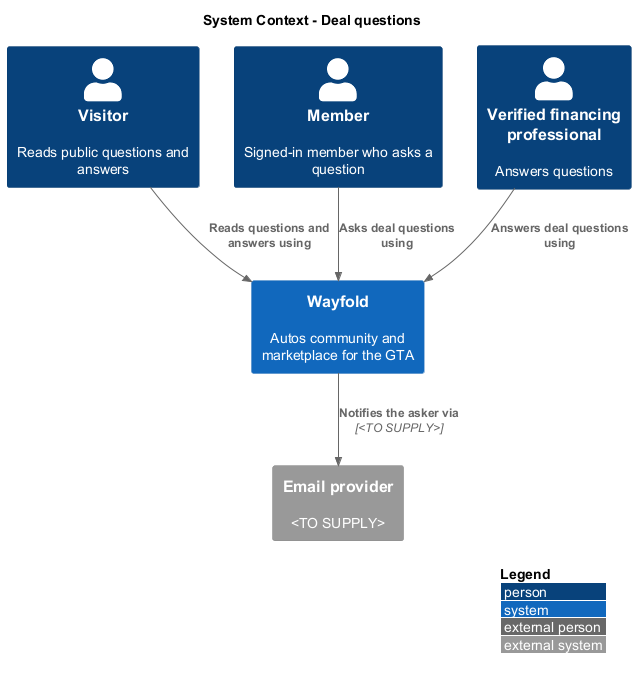
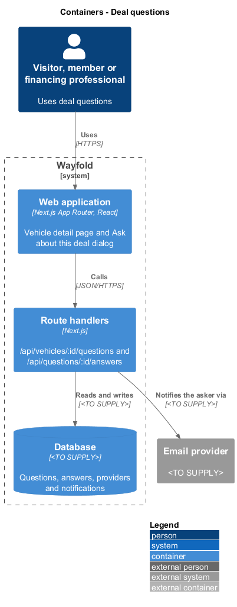
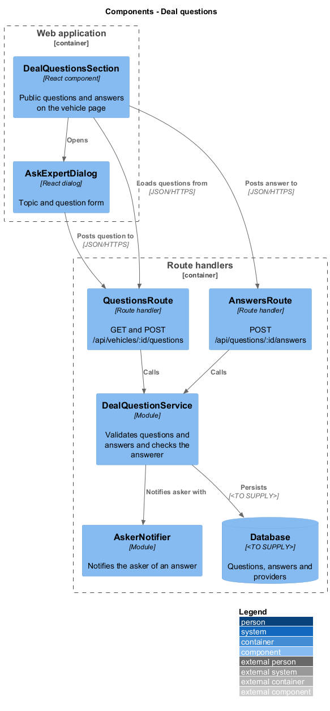
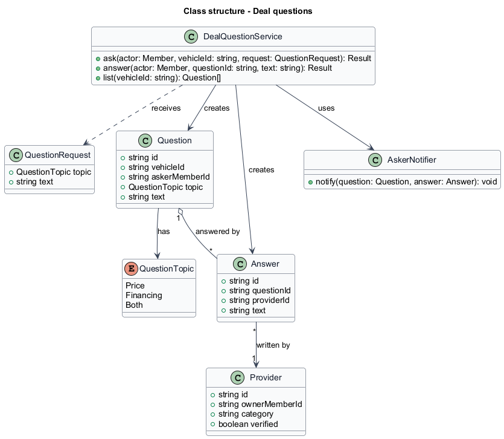
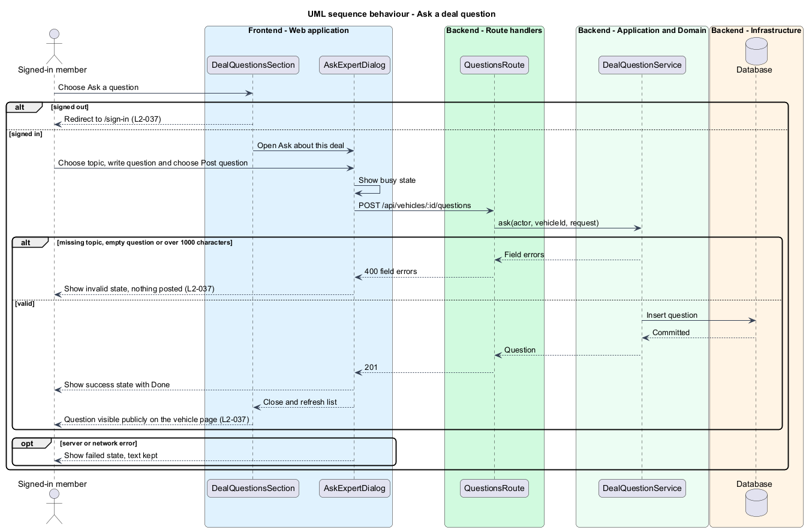
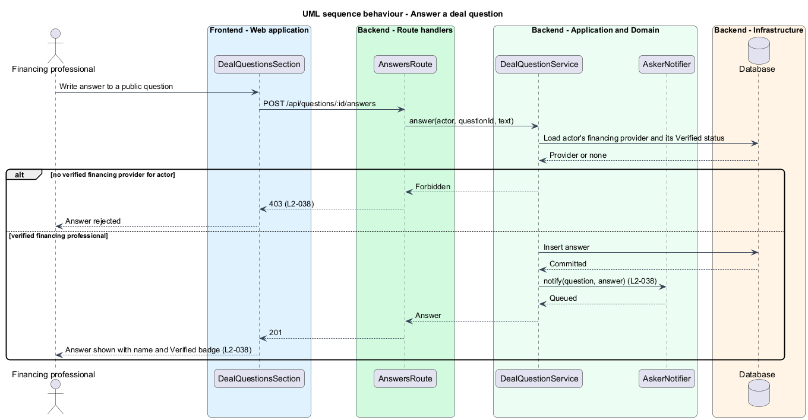
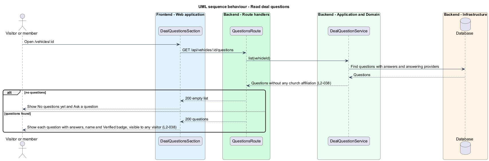

# Deal questions

## Overview

Wayfold is a responsive web application that is a micro-community for people in Toronto and the Greater Toronto Area who buy, sell and look after cars. A *deal question* is a public question about whether a vehicle's price or a financing offer is a good deal. A *topic* is the subject of the question: the price, the financing offer, or both. A *verified financing professional* is the owner of a financing provider profile whose credential Wayfold has checked.

This feature lets a signed-in member ask a deal question on a vehicle page and lets only a verified financing professional answer it. It sits in the `deal-guidance` subsystem and renders on the vehicle detail page of `view-vehicle`, beside the rating from `price-rating`.

The feature protects two concerns. Only verified financing professionals answer, and an answer carries the Verified badge and notifies the asker. Questions and answers are public, and no church affiliation appears with them.

## Description

The feature is a vertical slice from the vehicle page to the database. The screens follow the mocks `ask-expert` and `vehicle-detail` (default and no-questions states), and the financing state of `provider`.

- **`DealQuestionsSection`** - React component on `VehicleDetailPage` at `/vehicles/:id`. It states that questions and answers are public and lists each question with its answers, each showing the professional's name and Verified financing professional badge. With no questions it shows No questions yet and an Ask a question action. A signed-out visitor who chooses Ask a question is sent to `/sign-in`. The surface on which a verified professional writes an answer is `<TO SUPPLY>`, as no mock shows it.
- **`AskExpertDialog`** - React dialog titled Ask about this deal with a Topic choice (Is the price fair?, Is the financing offer good?, Both) and a question field of up to 1000 characters. It renders the default, busy (Sending...), invalid (Check the marked fields, with Write your question), failed (Could not send, text kept) and success (Done) states.
- **`QuestionsRoute`** - Next.js route handler for `GET` and `POST /api/vehicles/:id/questions`.
- **`AnswersRoute`** - route handler for `POST /api/questions/:id/answers`.
- **`DealQuestionService`** - module that validates the topic and the 1 to 1000 character text, and for an answer loads the actor's financing provider and rejects the request with 403 when it is not verified.
- **`AskerNotifier`** - module that notifies the asker of an answer. The channel (in-app notification, email, or both) is `<TO SUPPLY>`.
- **`Question`**, **`Answer`**, **`Provider`** - records. The `verified` value on `Provider` is set by the credential check of the provider profile design (`L2-033`). The provider profile of a financing professional shows the Verified badge.

The database technology and the email provider are `<TO SUPPLY>`. Whether a question may receive more than one answer, and whether a professional may answer a question more than once, are `<TO SUPPLY>`.

## Requirements

| L2 ID | Refines (L1) | Requirement |
|-------|--------------|-------------|
| `L2-037` | `L1-013` | Signed-in members shall ask public deal questions of 1 to 1000 characters with a topic. |
| `L2-038` | `L1-013` | Only verified financing professionals shall answer deal questions; their answers shall show the badge and notify the asker. |

Acceptance criteria from the specification: a signed-in member submitting a topic and a question of 1 to 1000 characters posts it publicly on the vehicle page. A missing topic, an empty question or one over 1000 characters shows an inline error and posts nothing. A signed-out visitor who tries to ask is sent to sign-in. A verified financing professional's answer appears with their name and Verified badge and the asker is notified. An unverified provider or ordinary member answering is rejected with 403. A visitor sees the public answer without a church affiliation.

## Diagrams

### System context

Visitors read, members ask and verified financing professionals answer. An email provider may notify the asker.

### Containers

The web application calls route handlers that persist questions and answers and notify the asker.

### Components

`QuestionsRoute` and `AnswersRoute` call `DealQuestionService`, which persists and calls `AskerNotifier`.

### Class structure

A `Question` has a `QuestionTopic` and receives `Answer` records, each written by a `Provider`.

### Behaviour - ask a deal question

A signed-out visitor is sent to sign-in. An invalid question posts nothing. A valid question appears publicly (`L2-037`).

### Behaviour - answer a deal question

Only a verified financing professional answers. Anyone else receives 403 (`L2-038`).

### Behaviour - read deal questions

Any visitor reads questions and answers. The no-questions state invites the first question (`L2-038`).

