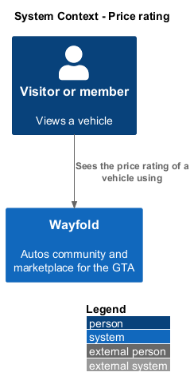
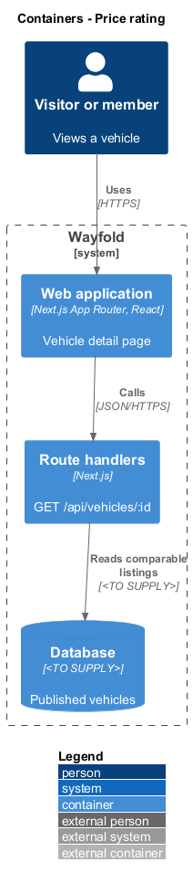
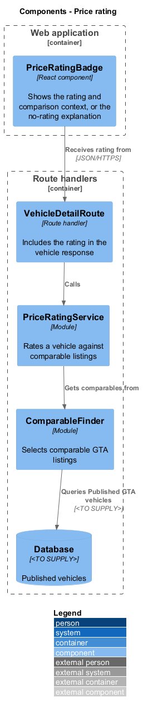
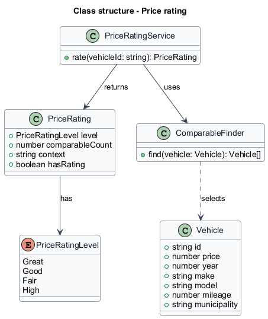
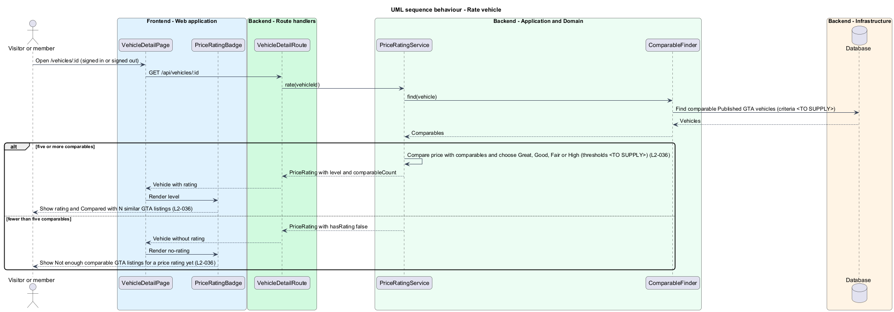

# Price rating

## Overview

Wayfold is a responsive web application that is a micro-community for people in Toronto and the Greater Toronto Area who buy, sell and look after cars. A *price rating* is a label of Great, Good, Fair or High that tells a viewer how a vehicle's price compares with similar vehicles. A *comparable listing* is a published GTA listing similar enough to the vehicle to serve as a price reference.

This feature rates each vehicle automatically from at least five comparable GTA listings. With fewer than five, no rating appears and the page says why. It sits in the `deal-guidance` subsystem and appears on the vehicle detail page of `view-vehicle` and on the result cards of `search-listings`.

The rating is a product of the listings on Wayfold. The result is identical for a signed-in member and a signed-out visitor.

## Description

The feature is a vertical slice from the detail page to the database. The screens follow the mock `vehicle-detail` in its default, private and no-rating states.

- **`PriceRatingBadge`** - React component on `VehicleDetailPage` at `/vehicles/:id`. With a rating, it shows the price, a label such as Good price, and the context line Compared with 12 similar GTA listings. Without a rating, it shows the price and the line Not enough comparable GTA listings for a price rating yet. The sold state keeps the rating.
- **`VehicleDetailRoute`** - Next.js route handler for `GET /api/vehicles/:id` that includes the `PriceRating` in its response. `VehicleSearchService` reads the same rating for result cards.
- **`PriceRatingService`** - module that gets the comparables, returns no rating when fewer than five exist, and otherwise compares the price with the comparables to choose a level.
- **`ComparableFinder`** - module that selects comparable GTA listings for a vehicle.
- **`PriceRating`** - value with `level`, `comparableCount`, `context` and `hasRating`.

The definition of comparable (year range, make, model, mileage band), whether the vehicle itself counts toward the five, the rule that maps a price position to Great, Good, Fair or High, and whether ratings are computed on read or stored are `<TO SUPPLY>`. The market price source is `<TO SUPPLY>`; the requirement names only comparable GTA listings, so this design uses no external price data. The database technology is `<TO SUPPLY>`.

## Requirements

| L2 ID | Refines (L1) | Requirement |
|-------|--------------|-------------|
| `L2-036` | `L1-013` | A vehicle shall show Great, Good, Fair or High based on at least five comparable GTA listings; with fewer than five, no rating shall appear. |

Acceptance criteria from the specification: with at least five comparable GTA listings, the detail page shows one of Great, Good, Fair or High with the comparison context. With fewer than five, no rating appears and the page explains why. A signed-out visitor sees the same rating or no-rating result.

## Diagrams

### System context

Any viewer sees a rating computed by Wayfold. No external system takes part.

### Containers

The detail page receives the rating from the route handler, which reads comparable listings from the database.

### Components

`PriceRatingService` asks `ComparableFinder` for comparables and returns a `PriceRating` to `VehicleDetailRoute`.

### Class structure

`PriceRatingService` returns a `PriceRating` with a `PriceRatingLevel` and uses `ComparableFinder` to select `Vehicle` records.

### Behaviour - rate vehicle

Five or more comparables produce a rating with context. Fewer produce the no-rating explanation. Both results are the same for every viewer (`L2-036`).

