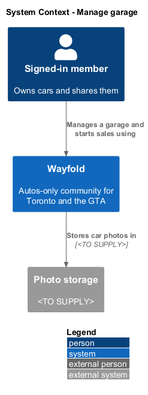
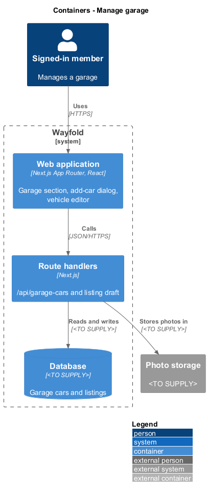
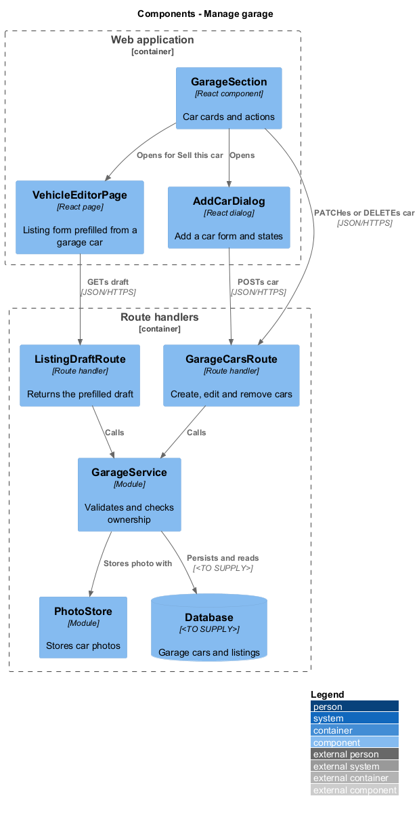
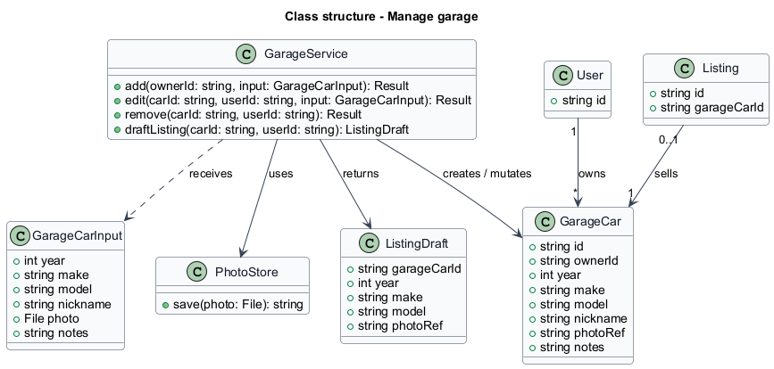
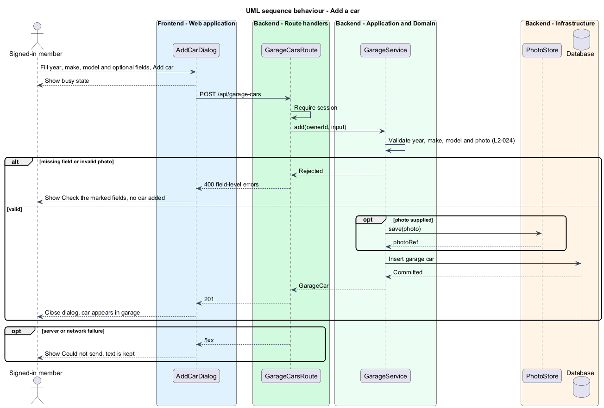
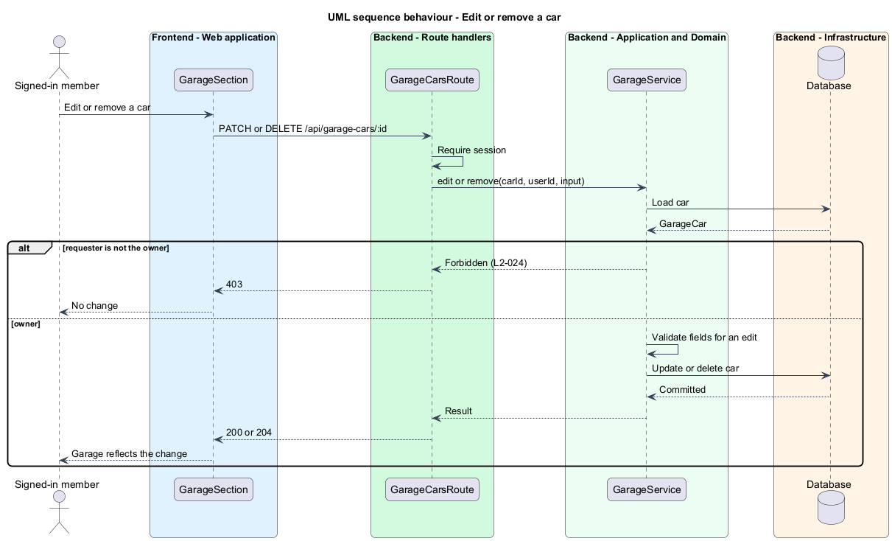
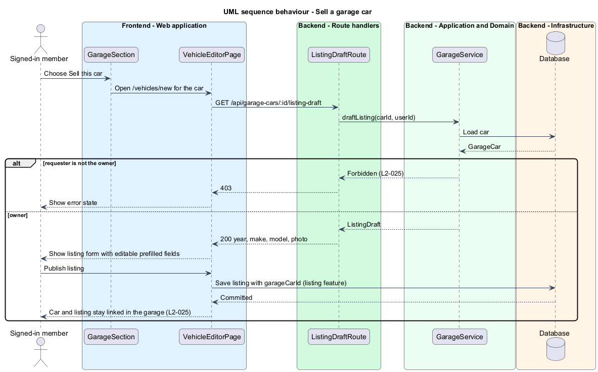

# Manage garage

## Overview

Wayfold is a responsive web application that is a micro-community for people in Toronto and the Greater Toronto Area (GTA) who buy, sell and look after cars. A *garage* is the set of cars that a member owns and shares on their profile. A *garage car* is one entry in a garage, made of a year, make and model, with an optional nickname, photo and notes. A *private sale* is a vehicle listing that a member, not a dealer, publishes.

This feature lets a member add, edit and remove cars in their garage and start a private sale from a garage car. The listing form opens with the year, make, model and photo already filled in, and the member can change them.

The feature sits in the `garage` subsystem. The `view-member-profile` feature shows the garage section. The vehicle listing feature owns saving the listing; this feature supplies the prefilled draft and keeps the link between the car and the listing.

## Description

The feature is a vertical slice from the profile garage section to the database.

- **`GarageSection`** - React component on `/members/:id`. It renders one card per car in a single column at 360 px with no horizontal scrolling (`L2-024`). For the owner it shows the Add a car action and a Sell this car action on each card.
- **`AddCarDialog`** - React dialog titled "Add a car to your garage" with Year, Make, Model, Nickname (optional), Photo (optional) and Notes (optional). The mock shows four states: default, busy ("Sending..."), invalid ("Check the marked fields" with "Enter a year", "Enter a make" and "Enter a model") and failed ("Could not send - Try again. Your text is still here.").
- **`GarageCarsRoute`** - route handler for `POST /api/garage-cars`, `PATCH /api/garage-cars/:id` and `DELETE /api/garage-cars/:id`. It requires a session.
- **`ListingDraftRoute`** - route handler for `GET /api/garage-cars/:id/listing-draft`. It returns the year, make, model and photo of the car.
- **`GarageService`** - module that validates fields, checks that the requester owns the car, and persists changes.
- **`PhotoStore`** - module that accepts an image and returns a stored reference. The storage service, accepted formats and size limit are `<TO SUPPLY>`.
- **`VehicleEditorPage`** - React page at `/vehicles/new`. When it opens from a garage car, it calls `ListingDraftRoute`, shows the text "Starting from Bluebird in your garage. You can change any detail." and fills Year, Make, Model and the photo.
- **`GarageCar`** - record with `id`, `ownerId`, `year`, `make`, `model`, `nickname`, `photoRef` and `notes`.
- **`Listing`** - record owned by the vehicle listing feature. It carries an optional `garageCarId`, which keeps the car and its sale listing linked (`L2-025`).

> **Deferred** until marketplace and recommendations exist (see AGENTS.md): `ListingDraftRoute`, `VehicleEditorPage` pre-fill, and the Sell this car action (`L2-025`).

The mocks show the add flow and the Sell this car action. The edit and remove interactions have no mock. The design provides the routes for them (`L2-024`) and leaves their screens `<TO SUPPLY>`.

The database technology, the auth library and the photo storage service are `<TO SUPPLY>`.

## Requirements

| L2 ID | Refines (L1) | Requirement |
|-------|--------------|-------------|
| `L2-024` | `L1-010` | A member shall add, edit and remove cars in their garage with year, make, model, optional nickname, photo and notes. |
| `L2-025` | `L1-010` | A member shall start a private sale from a garage car. |

Acceptance criteria from the specification: a car saved with year, make and model appears in the garage. The owner can edit or remove it and the garage reflects the change. Another member who tries to edit or remove the car receives 403. Missing required fields or an invalid photo produce inline errors and no car is added. At a 360 px viewport the cards fit in one column without horizontal scrolling (`L2-024`). The owner who chooses Sell this car sees the listing form with year, make, model and photo pre-filled and editable. Another member who tries to start a listing from that car receives 403. A saved listing stays linked to the car in the garage (`L2-025`).

## Diagrams

### System context

A signed-in member manages a garage and starts a sale through Wayfold. A photo storage service is `<TO SUPPLY>` and shown as an external system.

### Containers

The web application calls the garage route handlers, which persist cars to the database and photos to the photo storage.

### Components

The dialog and the garage section call `GarageCarsRoute`. The vehicle editor calls `ListingDraftRoute`. `GarageService` enforces ownership for both.

### Class structure

A `User` owns zero or more `GarageCar` records. A `Listing` may reference one `GarageCar`.

### Behaviour - add a car

The dialog posts the fields. The route rejects missing fields or an invalid photo with inline errors and creates no car (`L2-024`).

### Behaviour - edit or remove a car

The service allows only the owner to change or delete a car. Another member receives 403 (`L2-024`).

### Behaviour - sell a garage car

The owner chooses Sell this car. The editor loads a prefilled draft, and the saved listing keeps the link to the car. Another member receives 403 (`L2-025`).

