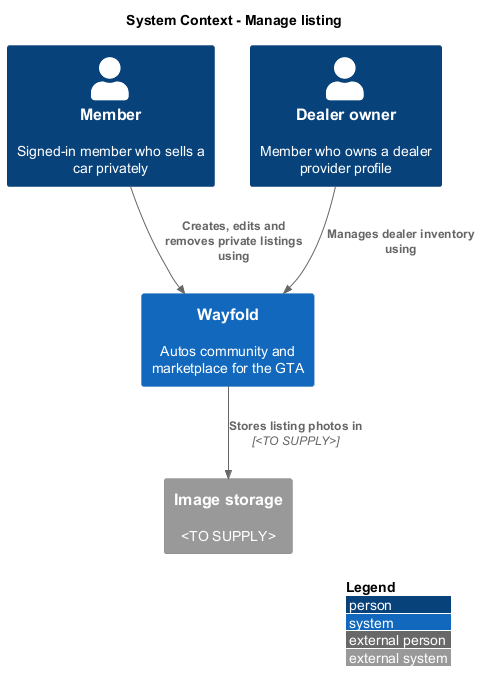
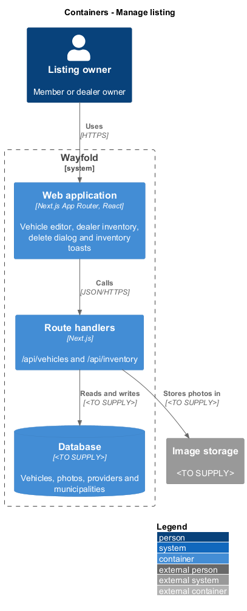
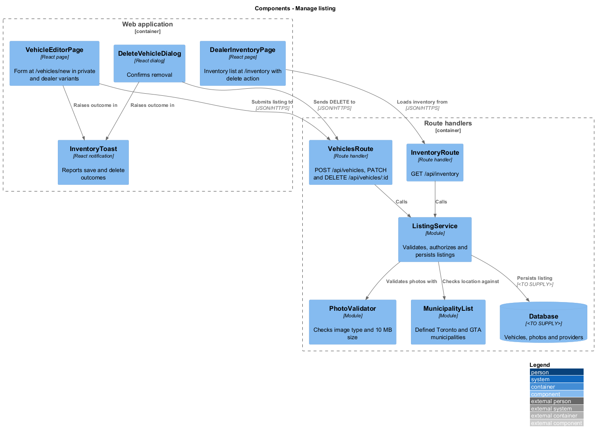
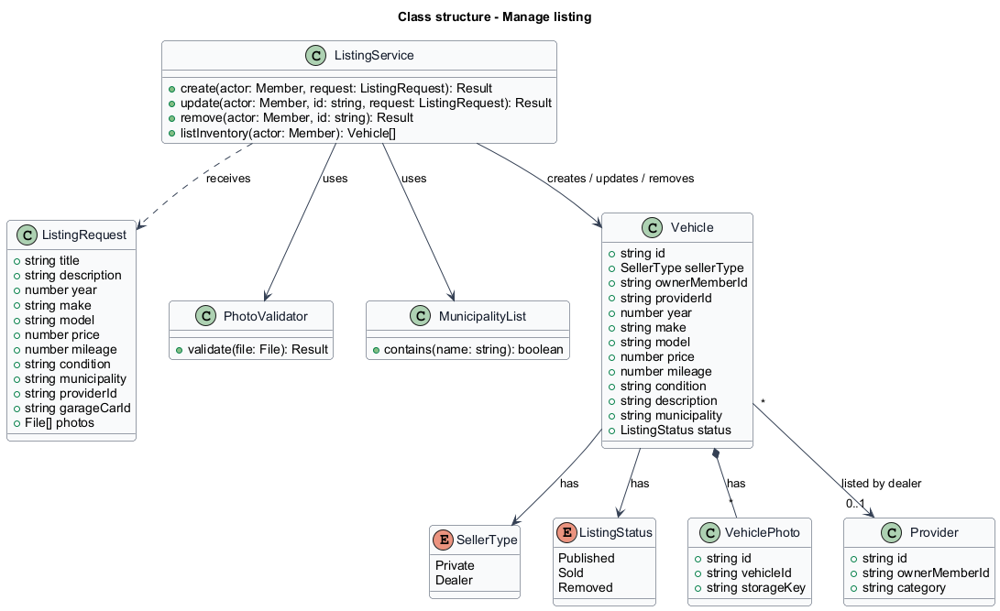
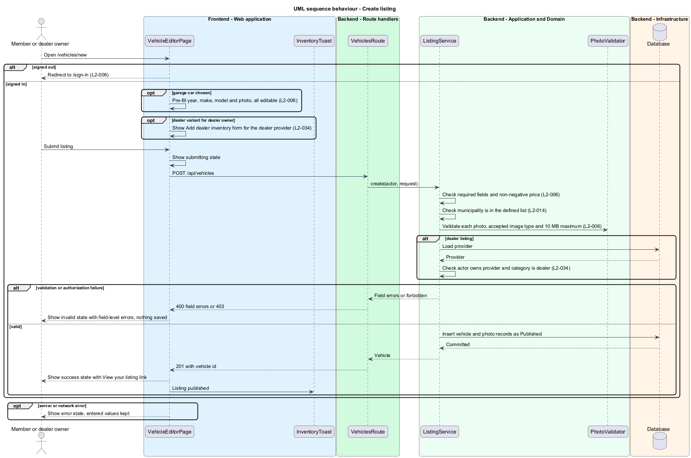
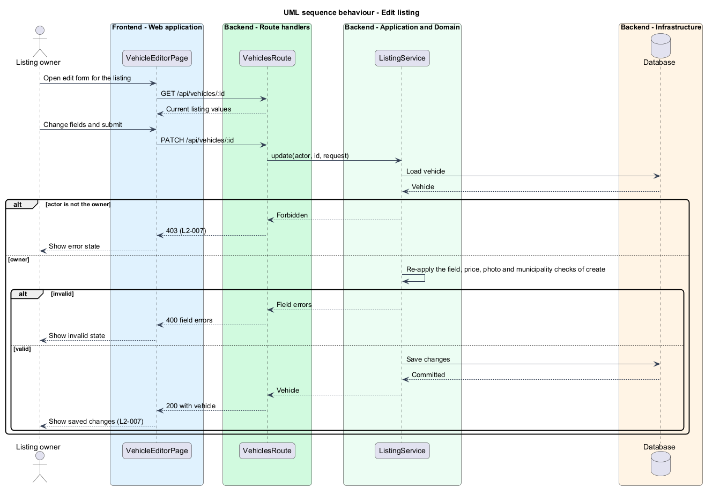
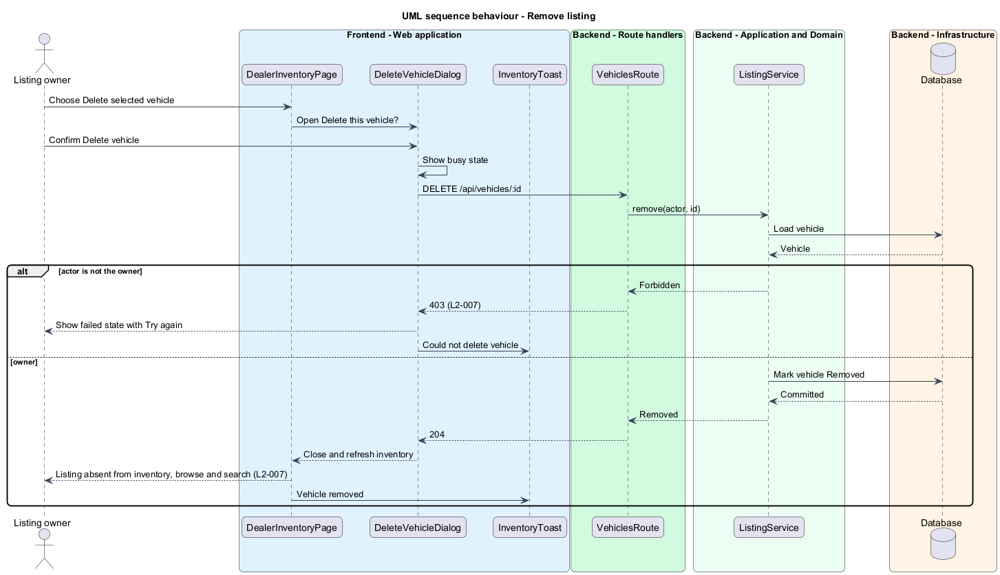
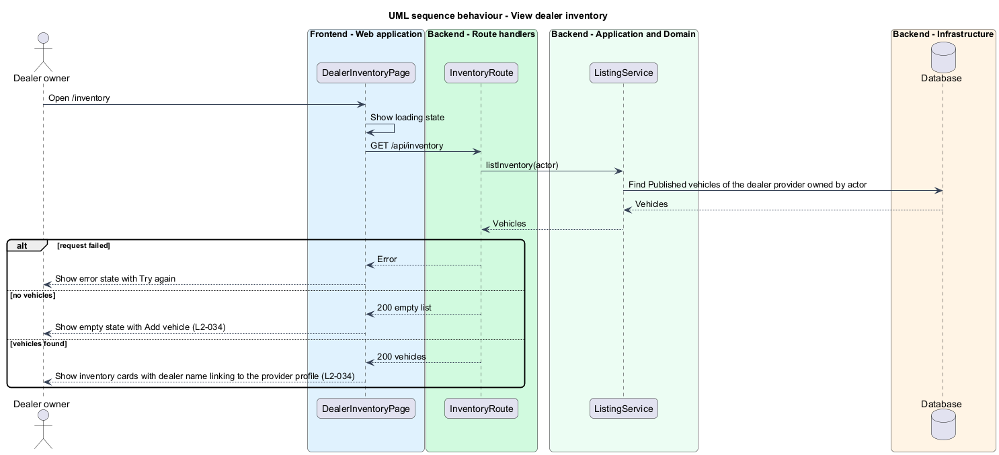

# Manage listing

## Overview

Wayfold is a responsive web application that is a micro-community for people in Toronto and the Greater Toronto Area who buy, sell and look after cars. A *listing* is a vehicle offered for sale, either by a member selling a car privately or by a dealer. A *dealer provider* is a provider profile in the dealer category. *Dealer inventory* is the set of listings that a dealer provider owns.

This feature lets a signed-in member create a private listing, lets the owner of a dealer provider add listings to the dealer inventory through the same form, and lets only the owner edit or remove a listing. It sits in the `marketplace` subsystem: `search-listings` and `view-vehicle` read the records that this feature writes.

The feature protects three concerns. Ownership decides who may change a listing. A listing carries a location from the defined list of GTA municipalities. Uploaded photos are limited to accepted image types of at most 10 MB.

## Description

The feature is a vertical slice from the sell form and inventory page to the database. The screens follow the mocks `vehicle-editor` (route `/vehicles/new`), `dealer-inventory` (route `/inventory`), `delete-vehicle` and `inventory-toast`.

- **`VehicleEditorPage`** - React page in the Next.js App Router titled Sell your car. The default state starts from a garage car with year, make, model and photo pre-filled and editable. The dealer state is titled Add dealer inventory and names the dealer provider. The page also renders the loading, error, invalid (field-level messages and a Check the listing summary), submitting and success (Your car is listed, with View your listing) states. A signed-out visitor is redirected to `/sign-in`. The route of the edit form is `<TO SUPPLY>`, as the mocks show no edit screen.
- **`DealerInventoryPage`** - React page at `/inventory` that lists the dealer's listings as cards with Add vehicle and Delete selected vehicle actions. It renders the loading, empty and error states.
- **`DeleteVehicleDialog`** - React dialog titled Delete this vehicle? with the default, busy and failed states. The failed state offers Try again.
- **`InventoryToast`** - React notification for outcomes such as Vehicle listed and Could not save listing, in the info, success, warning and danger variants.
- **`VehiclesRoute`** - Next.js route handler for `POST /api/vehicles`, `PATCH /api/vehicles/:id` and `DELETE /api/vehicles/:id`. It authenticates the session and calls the service.
- **`InventoryRoute`** - route handler for `GET /api/inventory`.
- **`ListingService`** - module that validates required fields and a non-negative price, checks ownership, checks that a dealer listing names a dealer provider owned by the actor, and persists the change.
- **`PhotoValidator`** - module that accepts only image types in the accepted list and files of at most 10 MB. The accepted list is `<TO SUPPLY>`.
- **`MunicipalityList`** - module holding the defined Toronto and GTA municipalities. The complete list is `<TO SUPPLY>`.
- **`Vehicle`**, **`VehiclePhoto`**, **`Provider`** - records. `Vehicle` holds the seller type, owner, optional provider, vehicle fields, municipality and a status of Published, Sold or Removed. Removal sets the status so that browse and search exclude the listing.

The database technology, image storage and the garage-car pre-fill entry point (for example a query parameter) are `<TO SUPPLY>`. The mocks show no removal control for a private listing, so its location is `<TO SUPPLY>`.

## Requirements

| L2 ID | Refines (L1) | Requirement |
|-------|--------------|-------------|
| `L2-006` | `L1-003` | A signed-in member shall create a private vehicle listing with title, description, price, vehicle details, photos, and GTA location, either from scratch or from a garage car. |
| `L2-007` | `L1-003` | Only a listing's owner shall edit or remove it. |
| `L2-034` | `L1-003` | Dealer providers shall list inventory through the vehicle listing form, and each dealer listing shall link to its dealer profile. |

Acceptance criteria from the specification: a signed-in user submitting all required fields publishes a listing visible in browse results. A missing required field or a negative price produces field-level errors and saves nothing. A file that is not an accepted image type or exceeds 10 MB is rejected. A signed-out visitor is redirected to sign-in. A listing created from a garage car pre-fills year, make, model and photo, all editable. The owner's edits are saved and shown, and a removed listing no longer appears in browse or search. Another user's edit or remove request is rejected with 403. The owner of a dealer provider publishes a listing that appears in the dealer inventory and the shared vehicle search. A non-owner or a provider of another category adding dealer inventory is rejected with 403. The listing-form location accepts only municipalities in the defined list (`L2-014`).

## Diagrams

### System context

A member or dealer owner manages listings through Wayfold, which keeps photos in an image store.

### Containers

The web application calls the route handlers, which persist to the database and the image store.

### Components

The pages and dialog call `VehiclesRoute` and `InventoryRoute`. `ListingService` applies validation and ownership rules and persists through the database.

### Class structure

`ListingService` receives a `ListingRequest` and creates, updates or removes a `Vehicle`. A dealer `Vehicle` references its `Provider`.

### Behaviour - create listing

A signed-out visitor is redirected. A valid submission publishes the listing, and an invalid or unauthorized one saves nothing (`L2-006`, `L2-034`).

### Behaviour - edit listing

Only the owner saves changes. Another user receives 403 (`L2-007`).

### Behaviour - remove listing

The owner confirms in the dialog and the listing leaves inventory, browse and search. A non-owner receives 403 (`L2-007`).

### Behaviour - view dealer inventory

The inventory page shows loading, error, empty and populated states (`L2-034`).

