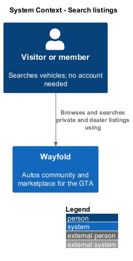
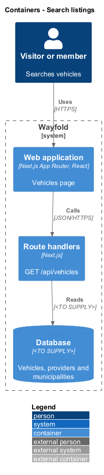
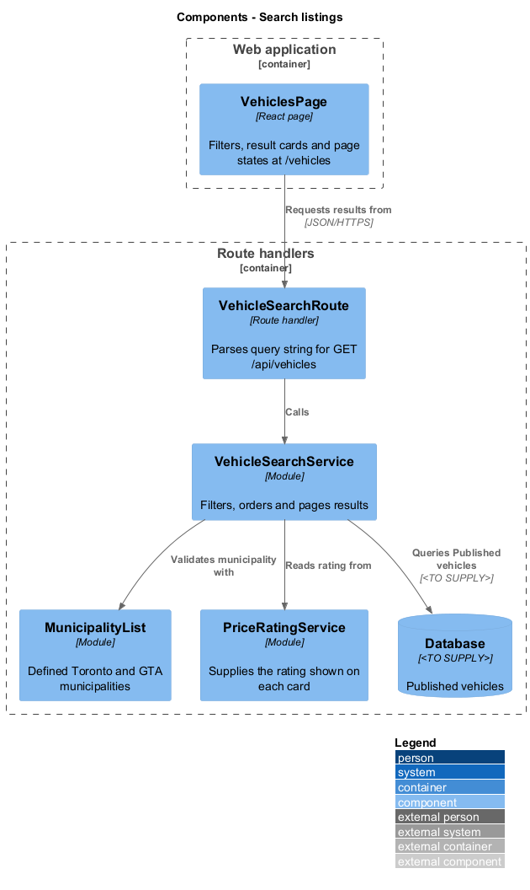
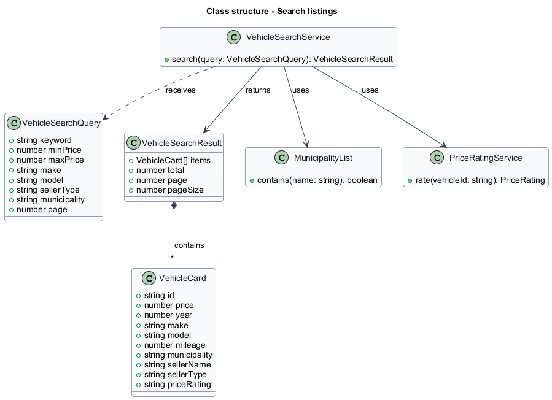
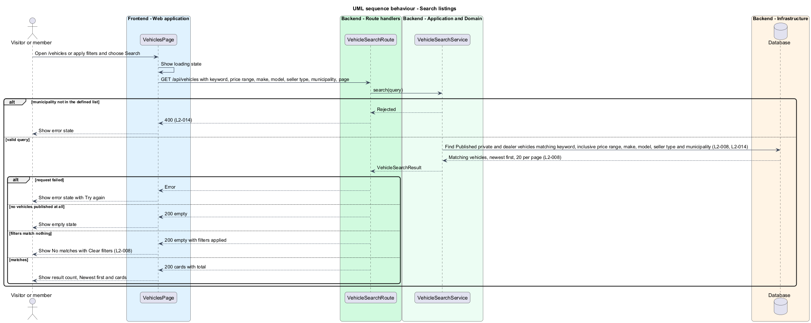

# Search listings

## Overview

Wayfold is a responsive web application that is a micro-community for people in Toronto and the Greater Toronto Area who buy, sell and look after cars. A *private listing* is a vehicle offered by a member. A *dealer listing* is a vehicle offered by a dealer provider. *Seller type* is the distinction between the two. A *municipality* is an entry in the defined list of Toronto and GTA places that a listing carries as its location.

This feature lets any visitor or member browse private and dealer listings together on one page and narrow them by seller type, make and municipality, and by the keyword, price range and model that the requirement adds. It sits in the `marketplace` subsystem and reads the listings that `manage-listing` writes. Cards link to the detail page described in `view-vehicle`.

Browsing needs no account. The feature scopes every result to the GTA through the municipality filter.

## Description

The feature is a vertical slice from the Vehicles page to the database. The screen follows the mock `vehicles` at route `/vehicles`.

- **`VehiclesPage`** - React page in the Next.js App Router. It renders a search form with Seller type (All sellers, Private sellers, Dealers), Make, GTA municipality and a Search action, and a result list that shows the total count, the Newest first order and cards. Each card shows price, year, make, model, mileage, municipality, the price rating and the seller (member name for a private seller, dealer name for a dealer). The page also renders the loading, empty, error and no-results states. The no-results state shows No matches and Clear filters. The empty state is reached when no listing is published. The error state offers Try again.
- **`VehicleSearchRoute`** - Next.js route handler for `GET /api/vehicles`. It parses the query string into a `VehicleSearchQuery`.
- **`VehicleSearchService`** - module that applies the filters, orders results newest first, returns 20 per page and rejects a municipality outside the defined list.
- **`MunicipalityList`** - module holding the defined municipalities. The complete list is `<TO SUPPLY>`.
- **`PriceRatingService`** - module described in `price-rating` that supplies the rating on each card.
- **`VehicleCard`** and **`VehicleSearchResult`** - response types.

The database technology, the keyword matching approach (fields searched and ranking) and the make and model value lists are `<TO SUPPLY>`. The mock shows only the seller type, make and municipality controls. The keyword, price range and model inputs required by `L2-008` have no mock and their layout is `<TO SUPPLY>`.

## Requirements

| L2 ID | Refines (L1) | Requirement |
|-------|--------------|-------------|
| `L2-008` | `L1-003` | Visitors and members shall browse private and dealer vehicle listings together and search by keyword, price range, make, model and seller type. |
| `L2-014` | `L1-005` | Listings, providers and recommended products shall carry a location chosen from a defined list of Toronto and GTA municipalities, and users shall filter each directory by it. |

Acceptance criteria from the specification: opening the marketplace shows published listings newest first, 20 per page. A keyword shows only matching listings. A price range shows only listings inside the inclusive range. A search with no matches shows an empty-state message. A seller type of Private or Dealer shows only that seller type. Filtering by one municipality shows only listings in it. A location outside the list sent directly to the API is rejected.

## Diagrams

### System context

A visitor or member searches all listings through Wayfold. No external system takes part.

### Containers

The web application calls one route handler that reads the database.

### Components

`VehiclesPage` calls `VehicleSearchRoute`. `VehicleSearchService` filters through the database and reads the rating from `PriceRatingService`.

### Class structure

`VehicleSearchService` receives a `VehicleSearchQuery` and returns a `VehicleSearchResult` that contains `VehicleCard` items.

### Behaviour - search listings

The service filters private and dealer listings together. The page shows the error, empty, no-results or populated state (`L2-008`, `L2-014`).

