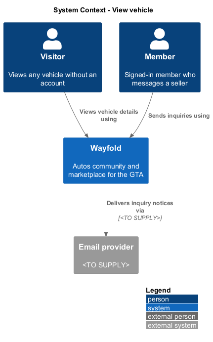
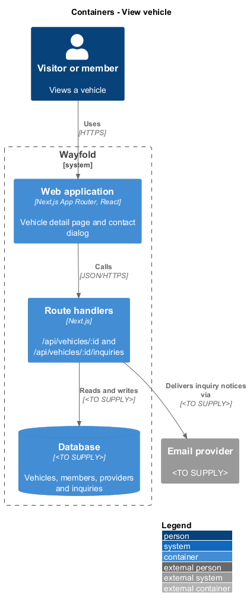
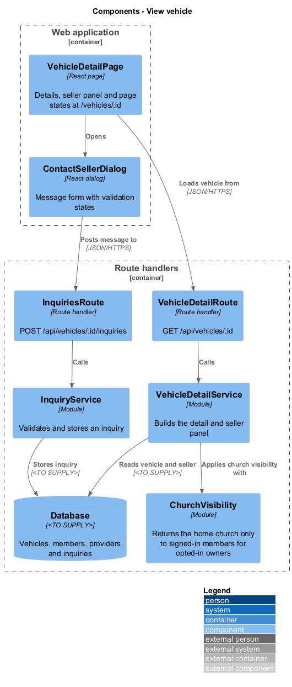
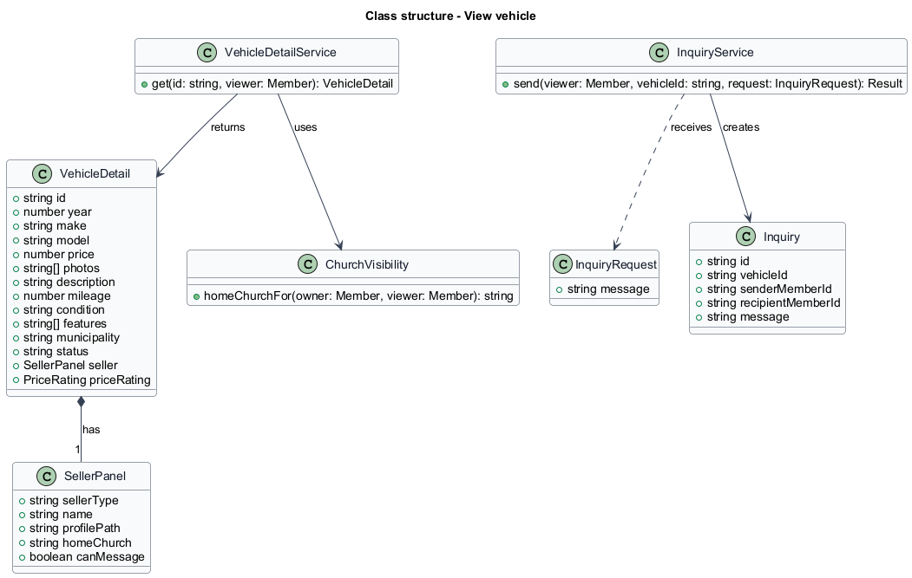
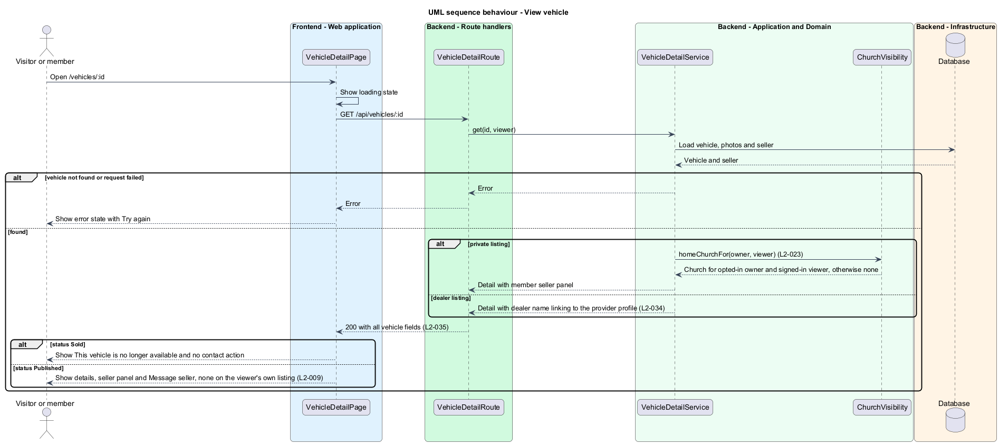
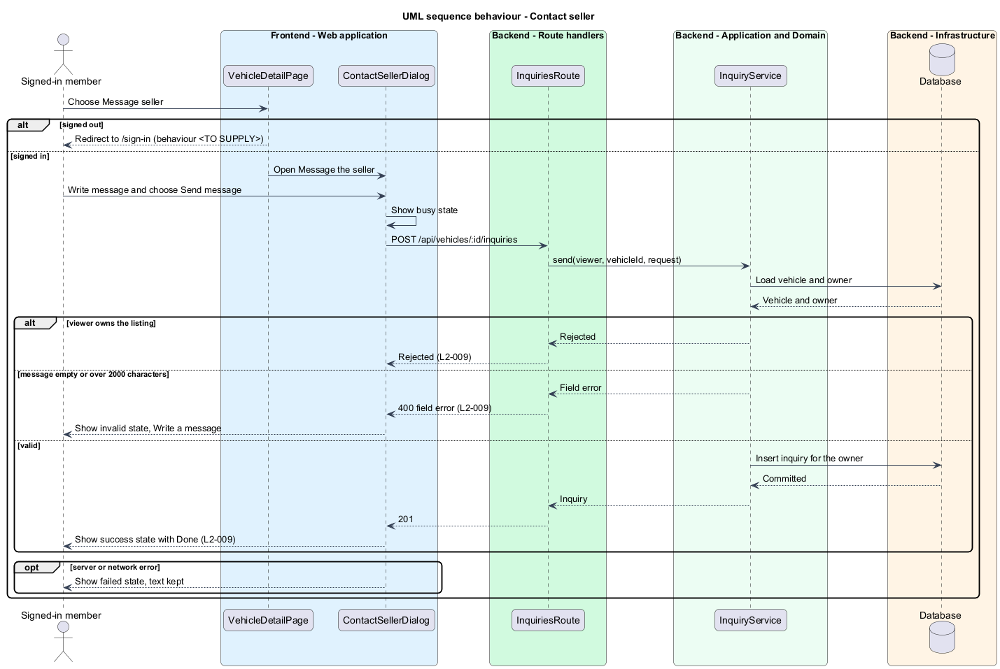

# View vehicle

## Overview

Wayfold is a responsive web application that is a micro-community for people in Toronto and the Greater Toronto Area who buy, sell and look after cars. A *vehicle detail page* is the page that shows every attribute of one listing. A *seller panel* is the part of that page that identifies the seller as a private member or a dealer. An *inquiry* is a message that a signed-in member sends to a listing's owner.

This feature gives every vehicle its own detail page and lets a signed-in member message the seller. It sits in the `marketplace` subsystem: `search-listings` links to the page, `manage-listing` writes the data, and the price rating and the public deal questions on the same page come from `price-rating` and `deal-questions`.

The feature protects two concerns. The seller's home church is returned only to signed-in members and only when the owner opted in. A listing owner is never offered an inquiry action on their own listing.

## Description

The feature is a vertical slice from the detail page to the database. The screens follow the mocks `vehicle-detail` at route `/vehicles/:id` and `contact-dealer`.

- **`VehicleDetailPage`** - React page in the Next.js App Router. It shows year, make, model, price, photos, description, mileage, condition, features, GTA area and the seller panel. A dealer panel shows the dealer name with a View dealer profile link. A member panel shows the member's name and, for a signed-in viewer of an opted-in owner, the home church with a cross icon and text. The page renders the default (dealer), private, loading, error, sold, no-rating and no-questions states. The sold state replaces the contact action with This vehicle is no longer available. At a 360 px viewport the photos, details and contact action are reachable without horizontal scrolling.
- **`ContactSellerDialog`** - React dialog titled Message the seller, with a message field of up to 2000 characters and the default, busy, invalid, failed and success states. The failed state keeps the typed text.
- **`VehicleDetailRoute`** - Next.js route handler for `GET /api/vehicles/:id`.
- **`InquiriesRoute`** - route handler for `POST /api/vehicles/:id/inquiries`.
- **`VehicleDetailService`** - module that loads the vehicle and seller and builds the `VehicleDetail` and `SellerPanel`.
- **`ChurchVisibility`** - module that returns a home church only for a signed-in viewer and an opted-in owner (`L2-023`).
- **`InquiryService`** - module that rejects an empty message, a message over 2000 characters and an inquiry on the viewer's own listing, and stores the `Inquiry`.

The database technology and the delivery of an inquiry to the owner (an inbox, email, or both) are `<TO SUPPLY>`. The behaviour of Message seller for a signed-out visitor is `<TO SUPPLY>`, as `L2-009` covers only signed-in users. No requirement defines how a listing becomes Sold, so the transition is `<TO SUPPLY>`. The home church of a provider owner, covered by the second criterion of `L2-023`, belongs to the provider profile design.

## Requirements

| L2 ID | Refines (L1) | Requirement |
|-------|--------------|-------------|
| `L2-035` | `L1-003` | Every vehicle shall have a detail page with year, make, model, price, photos, description, mileage, condition, features, GTA area and a seller panel for either a private member or dealer. |
| `L2-009` | `L1-003` | A signed-in user shall send an inquiry message to a listing's owner. |
| `L2-023` | `L1-002` | An opted-in church affiliation shall appear with a private seller, recommendation author or provider owner only to signed-in members. |

Acceptance criteria from the specification: a published private listing shows all vehicle fields and the member seller panel, and a published dealer listing shows all vehicle fields and a dealer profile link. At a 360 px viewport photos, details and the contact action are reachable without horizontal scrolling. A signed-in user viewing another user's listing sends a message that the owner receives. The owner viewing the listing is offered no inquiry action. A message over 2000 characters or empty is rejected. An opted-in member's home church appears with a cross icon and text to another signed-in member viewing the seller panel. A signed-out visitor, or an owner who has not opted in, sees and receives no church affiliation. This design applies `L2-023` to the listing seller panel only.

## Diagrams

### System context

Visitors view vehicles and members send inquiries. An email provider may deliver inquiry notices.

### Containers

The web application loads the detail and posts inquiries through route handlers backed by the database.

### Components

`VehicleDetailService` builds the page and applies `ChurchVisibility`. `InquiryService` stores inquiries.

### Class structure

`VehicleDetail` holds one `SellerPanel`. `InquiryService` creates an `Inquiry` from an `InquiryRequest`.

### Behaviour - view vehicle

The page shows the error state, the sold state, or the full detail with the seller panel (`L2-035`, `L2-023`).

### Behaviour - contact seller

A signed-in non-owner sends a valid message. An empty or oversized message is rejected (`L2-009`).

