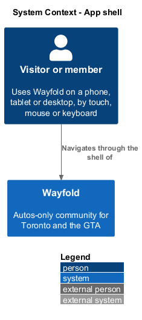
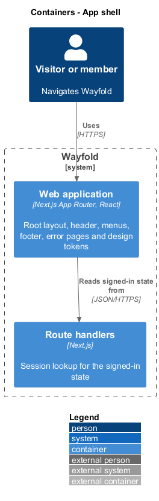
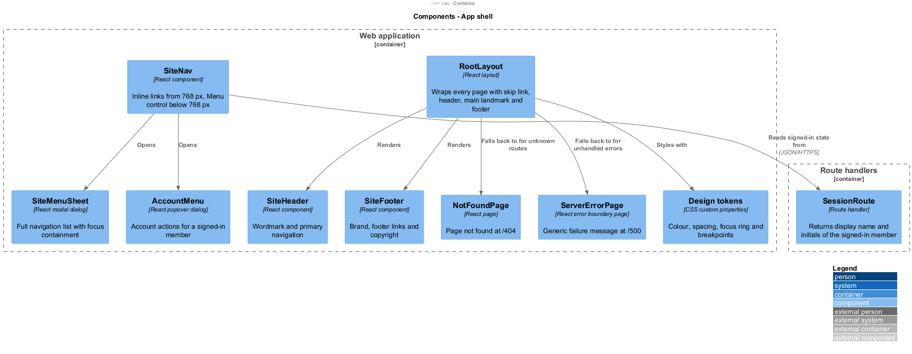
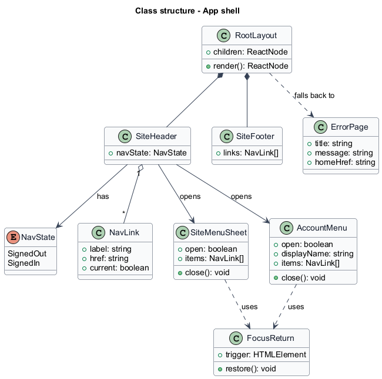
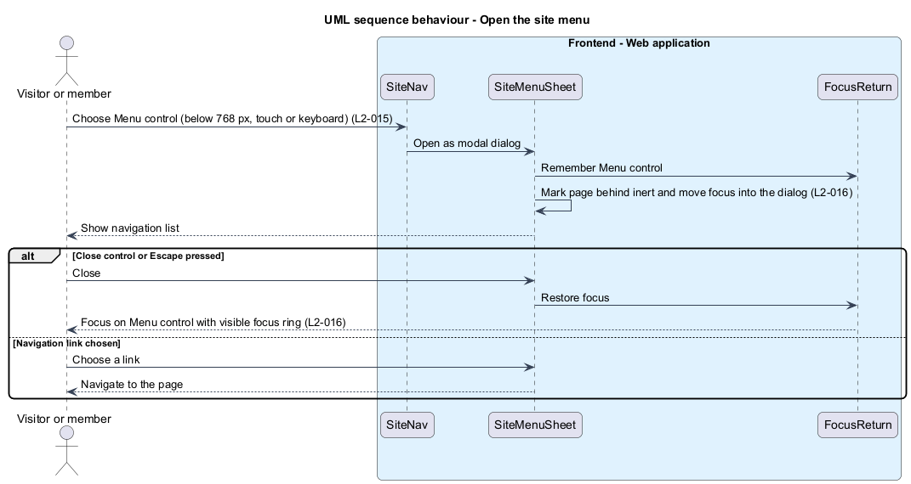
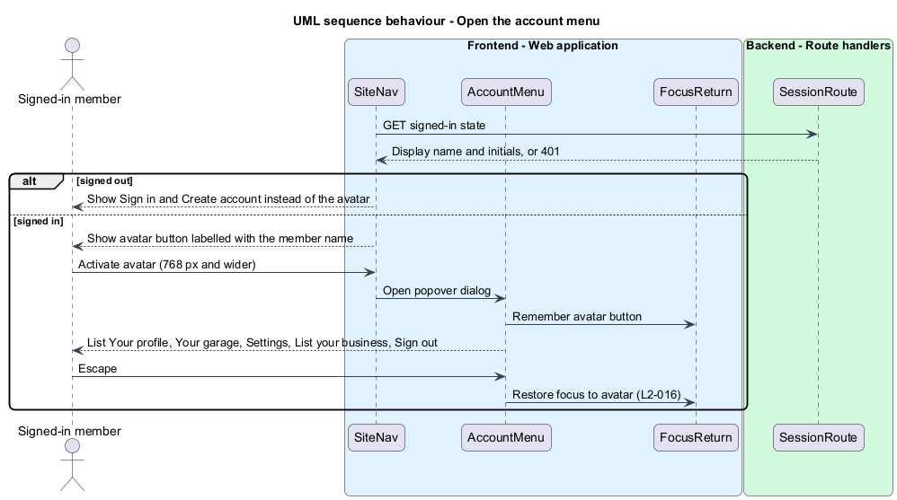
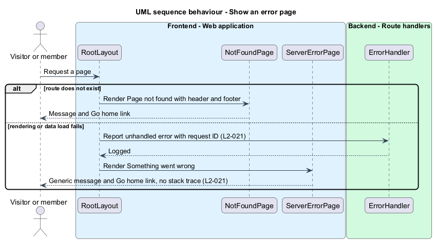

# App shell

## Overview

Wayfold is a responsive web application that is a micro-community for people in Toronto and the Greater Toronto Area who buy, sell and look after cars. The *app shell* is the frame that surrounds every page: a skip link, a header with the wordmark and primary navigation, a main content landmark and a footer. The shell also provides the two *error pages*, which are the page-not-found page and the something-went-wrong page.

This feature sits in the `platform` subsystem, which holds the cross-cutting slices that every other subsystem relies on. Each page in `accounts`, the marketplace and the community renders inside the shell, so the shell fixes how the product adapts to screen size and how a keyboard or screen reader user moves through it.

Three terms are used below.

**breakpoint** — viewport width at which the layout changes

**site menu** — modal dialog that lists the primary destinations when the header has no room for inline links

**account menu** — popover dialog that lists actions for the signed-in member

The mocks in `docs/mocks` define the shell behaviour: the `site-menu` and `account-menu` dialogs, and the `not-found` and `server-error` pages. The design tokens in `docs/design-system/tokens` define colour, spacing, the focus ring and the breakpoints.

## Description

The feature is a vertical slice from the root layout to the single route handler that reports the signed-in state.

- **`RootLayout`** — React layout in the Next.js App Router. It renders the skip link, `SiteHeader`, the `main` landmark (`id="main"`, focusable so the skip link lands on it) and `SiteFooter` around every page. It sets `lang="en-CA"`.
- **`SiteHeader`** — renders the wordmark with the *Toronto* tag and `SiteNav`. The tag is hidden below 384 px (24 rem) so the wordmark fits a 360 px viewport.
- **`SiteNav`** — renders the primary navigation. From 768 px (48 rem) the links appear inline. Below 768 px a *Menu* control replaces them and opens `SiteMenuSheet`. A signed-out visitor sees Vehicles, Providers, Products, Sign in and Create account. A signed-in member sees Feed, Vehicles, Providers, Products, Sell your car and the avatar button.
- **`SiteMenuSheet`** — modal dialog (`role="dialog"`, `aria-modal="true"`). It lists the destinations in a `nav` landmark. A signed-out visitor sees Vehicles, Providers, Products, Sign in and Create account. A signed-in member also sees Your profile, Your garage, Settings, List your business and Sign out. It marks the page behind it `inert`, moves focus inside, closes on the Close control or Escape, and restores focus to the Menu control. From 768 px it docks to the right edge instead of filling the screen.
- **`AccountMenu`** — popover dialog opened by the avatar button, shown from 768 px. It lists Your profile, Your garage, Settings, List your business and Sign out. The avatar button has a visually hidden label that names the member.
- **`FocusReturn`** — small helper shared by both dialogs. It remembers the control that opened a dialog and restores focus to it on close.
- **`SiteFooter`** — brand line, footer links (Vehicles, Providers, Products, Create account) and the copyright line.
- **`NotFoundPage`** — page at `/404`. It shows the heading *Page not found*, the text "That page isn't here." and a *Go home* link.
- **`ServerErrorPage`** — page at `/500`. It shows the heading *Something went wrong*, the text "We couldn't load the page. Please try again." and a *Go home* link. It is the rendered result of the Next.js error boundary. The message is generic and shows no stack trace (L2-021).
- **`SessionRoute`** — route handler that returns the display name and initials of the signed-in member, or 401. Session creation and expiry belong to `accounts/sign-in-sign-out`.
- **Design tokens** — CSS custom properties from `docs/design-system/tokens/tokens.css`. The shell reads colour, spacing, the focus ring (2 px, 3 px offset) and layout values from them and defines no literal colours.

### Responsive behaviour

The tokens define the breakpoints `--layout-breakpoint-sm` 576 px, `md` 768 px, `lg` 992 px and `xl` 1200 px, and the extra-small range below 576 px. The shell uses 768 px for the switch between the Menu control and inline navigation. The layout container has a maximum width of 1440 px (90 rem) and a margin that grows at the larger widths. Mock review uses a 360 px viewport as the smallest width. No page shall scroll horizontally at 360, 576, 768, 992 and 1200 px.

### Accessibility behaviour

- Each page has one `h1`, landmarks for header, `nav`, `main` and footer, and a skip link as the first focusable element.
- Every interactive control is reachable and operable by keyboard and shows the focus ring from `--shadow-focus`.
- A form error is rendered next to its field, linked with `aria-describedby`, and announced through an alert or live region. Form components own this behaviour and the shell supplies the live region container.
- Text and interactive components use only token pairs listed in `docs/design-system/tokens/contrast-pairs.json`, which asserts 4.5:1 for text and 3:1 for user interface components in both themes.
- Forced-colours mode keeps borders and focus indicators visible.
- Automated scanning of each page with an accessibility checker is `<TO SUPPLY>` (tool and CI stage).

The hosting platform, the session mechanism and the analytics, if any, are `<TO SUPPLY>`.

## Requirements

| L2 ID | Refines (L1) | Requirement |
|-------|--------------|-------------|
| `L2-015` | `L1-006` | All screens shall adapt to the five viewport breakpoints without horizontal scrolling. |
| `L2-016` | `L1-007` | All screens shall meet WCAG 2.2 AA. |
| `L2-021` | `L1-009` | The system shall expose health and emit structured logs. |

Acceptance criteria from the specification for `L2-015`: at 360, 576, 768, 992 and 1200 px no horizontal scrollbar appears and all content is reachable. Below 576 px the marketplace shows listings in one column. From 992 px it shows multiple columns. Below 768 px navigation collapses into a menu control operable by keyboard and touch.

Acceptance criteria for `L2-016`: an automated checker reports no AA violations. Each interactive control is reachable, operable and shows a visible focus indicator by keyboard alone. A form error is associated with its field and announced to assistive technology. Contrast meets 4.5:1 for text and 3:1 for interface components.

Scope of `L2-021` in this feature: the not-found and server-error pages are mapped to `L2-021` in the mock manifest. Acceptance criteria 3 and 4 of `L2-021` are realized here: an unexpected error shown to a user has a generic message and no stack trace, and a request for a page that does not exist shows the not-found page with HTTP 404. Health and structured logging belong to `platform/observe-and-perform`.

## Diagrams

### System context

A visitor or member navigates Wayfold through the shell. No external system takes part.

### Containers

The web application holds the shell. One route handler supplies the signed-in state.

### Components

`RootLayout` renders the header, footer and error fallbacks. `SiteNav` opens `SiteMenuSheet` and `AccountMenu`.

### Class structure

`RootLayout` owns `SiteHeader` and `SiteFooter`. Both dialogs use `FocusReturn` to restore focus on close.

### Behaviour - open the site menu

Below 768 px the Menu control opens a modal dialog that holds focus and returns it on close (`L2-015`, `L2-016`).

### Behaviour - open the account menu

A signed-in member opens the account menu from the avatar button. A signed-out visitor sees Sign in and Create account instead.

### Behaviour - show an error page

An unknown route renders the not-found page. An unhandled error renders the server-error page with a generic message (`L2-021`).

