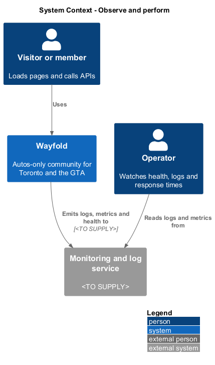
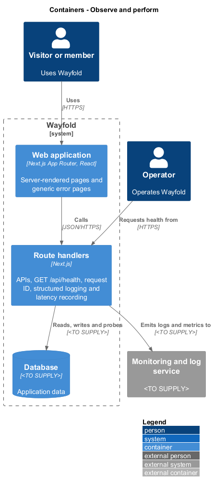
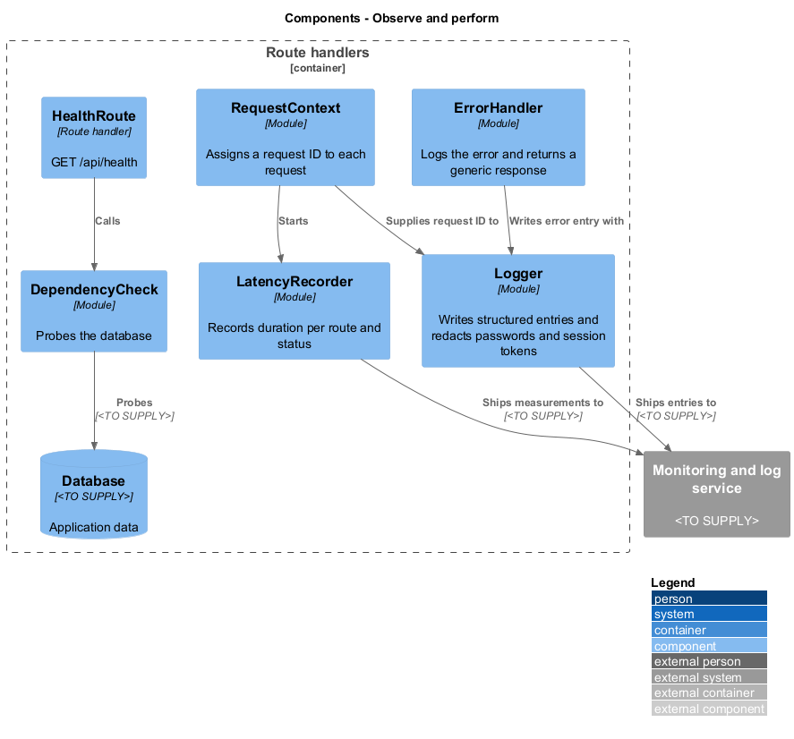
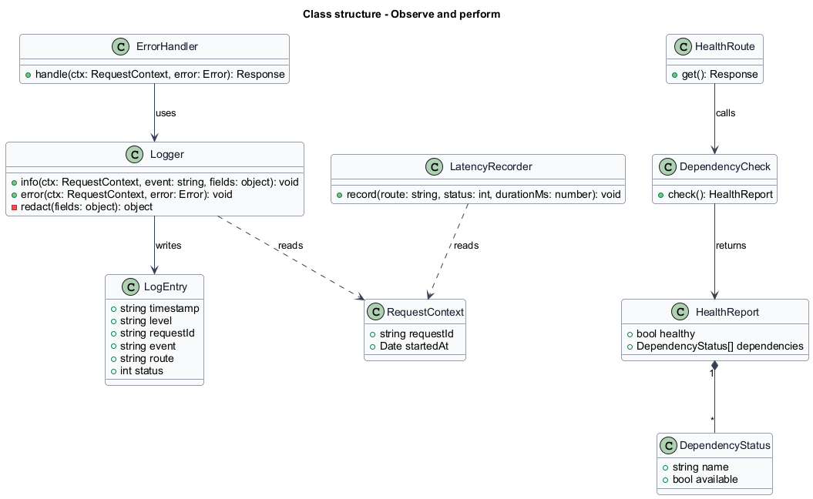
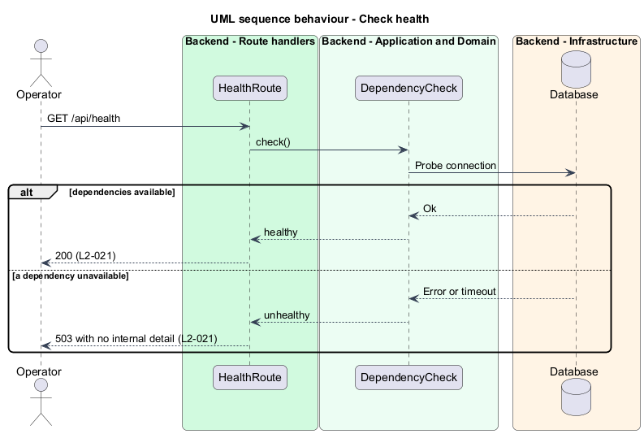
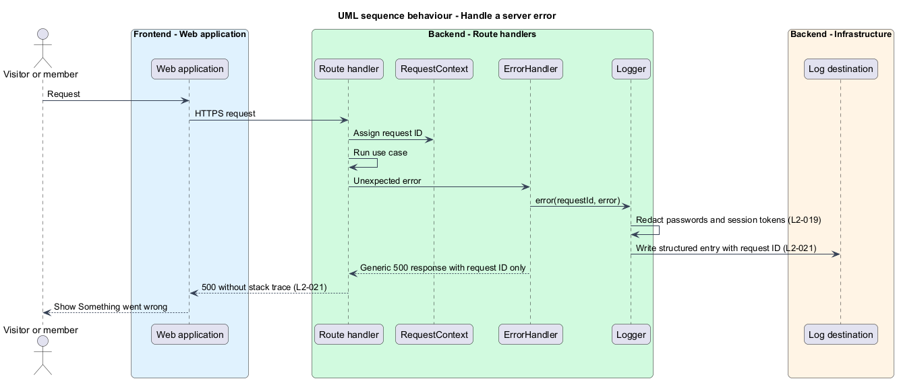
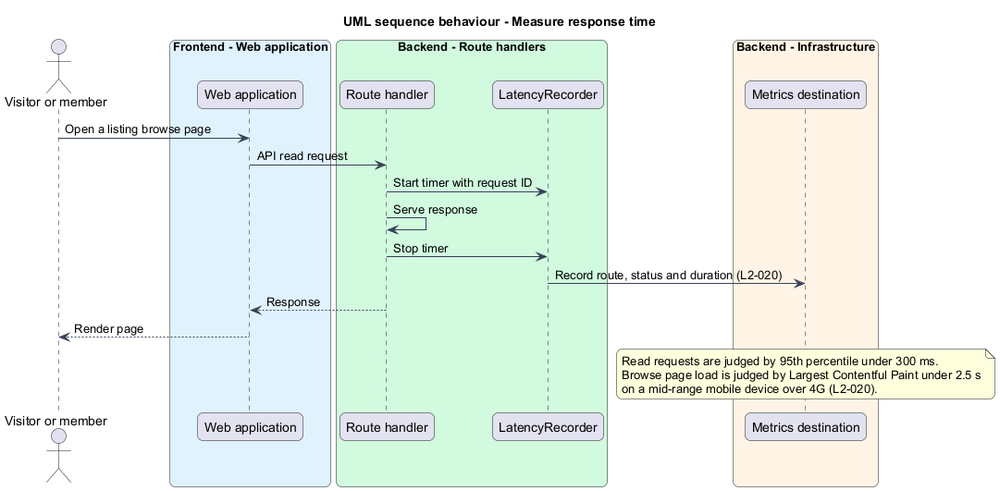

# Observe and perform

## Overview

Wayfold is a responsive web application that is a micro-community for people in Toronto and the Greater Toronto Area who buy, sell and look after cars. Members browse vehicle listings, mostly on phones, so response time shapes how the product feels. Operators need to see whether the system is working and to trace a failure.

This feature gives the system two capabilities. *Observability* is the ability to tell from outside whether the system works, through a health endpoint and structured logs. *Performance* is the response time budget for APIs and for the listing browse page. The feature sits in the `platform` subsystem and applies to every route handler.

Four terms are used below.

**health endpoint** — route that reports whether the system and its dependencies are available

**structured log entry** — log record written as named fields rather than free text

**request ID** — identifier assigned to one request and carried on every log entry for that request

**95th percentile** — response time below which 95 percent of measured requests fall

## Description

The feature is a vertical slice from the route handlers to the log and metric destinations.

- **`RequestContext`** — assigns a `requestId` to each request and records `startedAt`. The ID is taken from an inbound request header when one is present, and is generated otherwise. The header name is `<TO SUPPLY>`.
- **`Logger`** — writes a `LogEntry` with `timestamp`, `level`, `requestId`, `event`, `route` and `status`. Its `redact` step removes passwords and session tokens from every entry (`L2-019`).
- **`ErrorHandler`** — wraps each route handler. On an unexpected error it calls `Logger.error` with the request ID, then returns a generic `500` response that carries the request ID and no stack trace or internal message. The `ServerErrorPage` in `platform/app-shell` shows the same generic message to a person.
- **`HealthRoute`** — route handler for `GET /api/health`. It returns `200` when `DependencyCheck` reports all dependencies available and `503` otherwise. The response body names no internal detail.
- **`DependencyCheck`** — probes each dependency and returns a `HealthReport`. The database is the one dependency known today. Others are `<TO SUPPLY>`.
- **`LatencyRecorder`** — measures the duration of each request and records it with route and status.

### Performance budget

> **Deferred** until all features are complete and working (see AGENTS.md).

- API read requests: 95th percentile under 300 ms under normal load. The definition of normal load is `<TO SUPPLY>`.
- Listing browse page: Largest Contentful Paint under 2.5 s on a simulated mid-range mobile device over a 4G connection.

The design supports the budget through server rendering of the browse page, sized and lazily loaded images below the fold, and one round trip per list read. Caching, the image delivery service and the pagination size are `<TO SUPPLY>`. The measurement tool for Largest Contentful Paint and the load test tool are `<TO SUPPLY>`.

The hosting platform, the logging and metrics stack, the alert thresholds and the log retention period are `<TO SUPPLY>`.

## Requirements

| L2 ID | Refines (L1) | Requirement |
|-------|--------------|-------------|
| `L2-020` | `L1-009` | Pages and APIs shall respond quickly. |
| `L2-021` | `L1-009` | The system shall expose health and emit structured logs. |

Acceptance criteria from the specification for `L2-020`: under normal load the 95th percentile of API read requests is under 300 ms. A listing browse page on a simulated mid-range mobile device over 4G has Largest Contentful Paint under 2.5 s.

Acceptance criteria for `L2-021`: the health endpoint returns 200 when dependencies are available and 503 otherwise. Any server error writes a structured log entry with a request ID. An unexpected error shown to a user has a generic message and no stack trace.

## Diagrams

### System context

Visitors use Wayfold. An operator reads logs and metrics from a monitoring service that is `<TO SUPPLY>`.

### Containers

The route handlers emit logs and measurements and expose the health endpoint. The database is probed by the health check.

### Components

`RequestContext` supplies the request ID to `Logger` and `LatencyRecorder`. `HealthRoute` uses `DependencyCheck`. `ErrorHandler` writes through `Logger`.

### Class structure

`Logger` writes `LogEntry` records. `DependencyCheck` returns a `HealthReport` made of `DependencyStatus` items.

### Behaviour - check health

The health endpoint probes the database and returns 200 or 503 (`L2-021`).

### Behaviour - handle a server error

An unexpected error is logged with the request ID after redaction, and the caller receives a generic response (`L2-021`).

### Behaviour - measure response time

> **Deferred** until all features are complete and working (see AGENTS.md).

Each request is timed and recorded so the 95th percentile and the browse page budget can be judged (`L2-020`).

