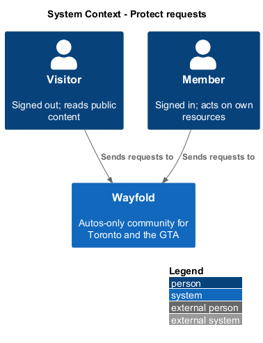
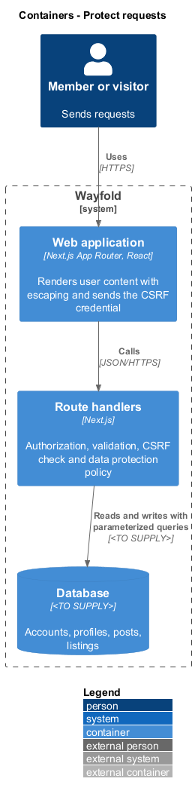
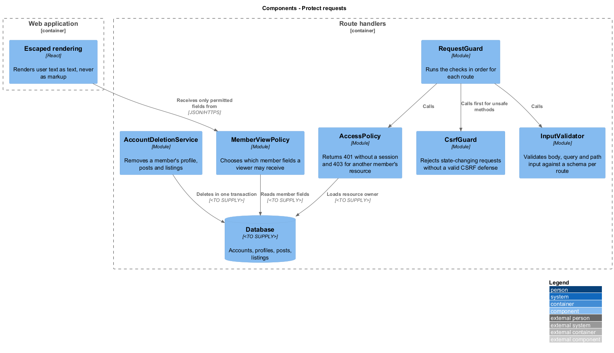
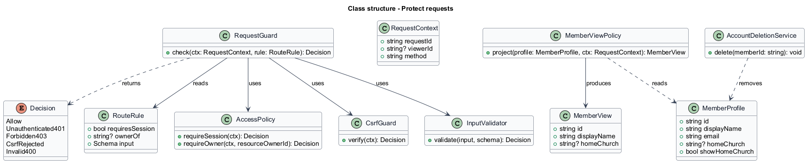
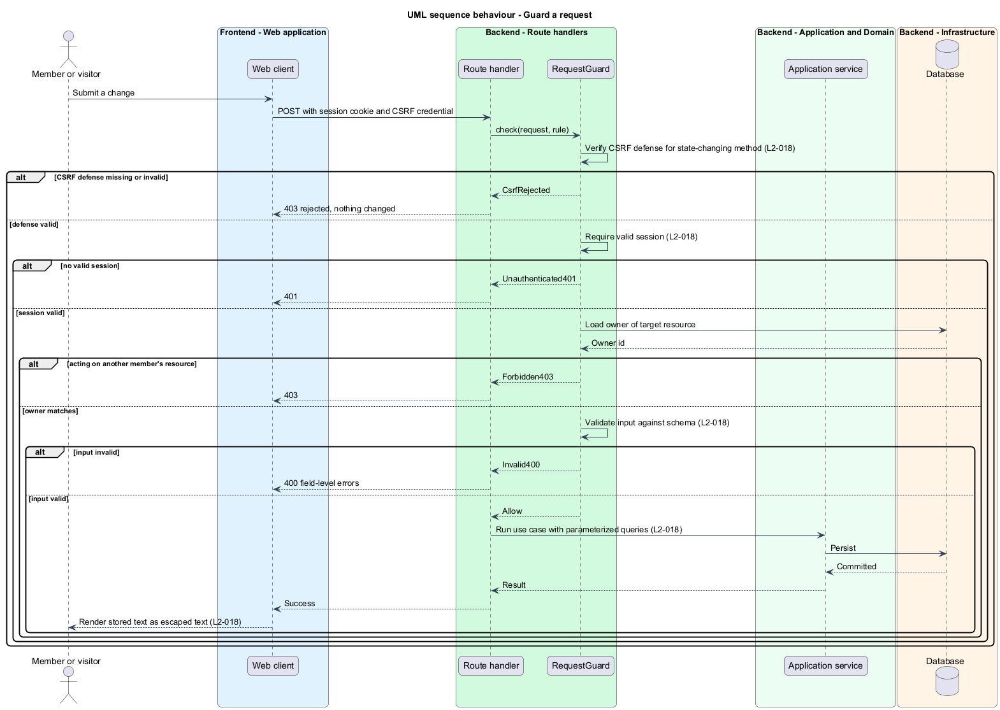
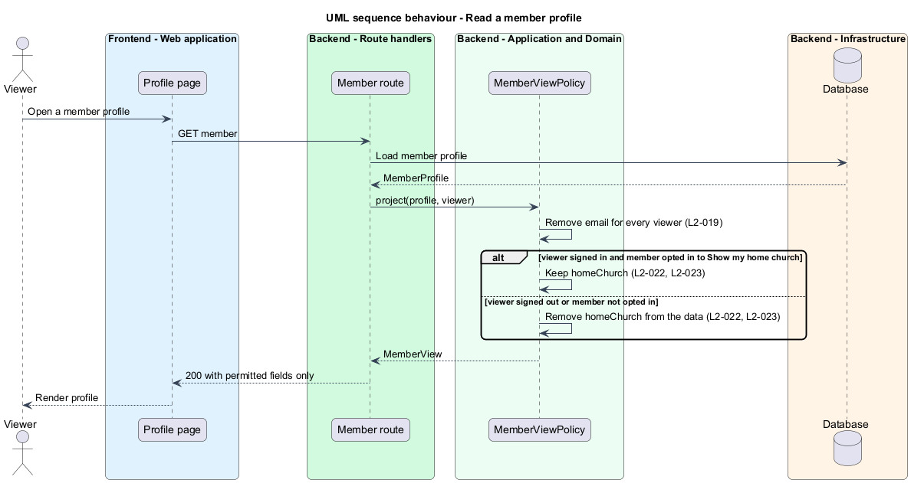
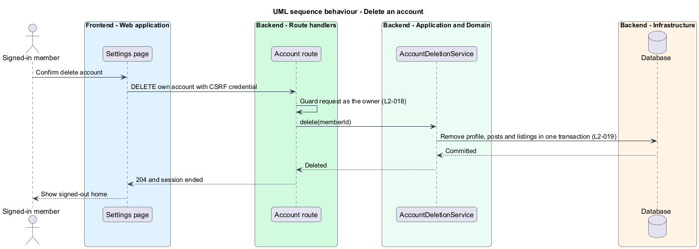

# Protect requests

## Overview

Wayfold is a responsive web application that is a micro-community for people in Toronto and the Greater Toronto Area who buy, sell and look after cars. Members hold accounts, post, list vehicles and may show a home church on their profile. Every one of those actions arrives as an HTTP request to a route handler.

This feature defines how each route handler decides whether a request may proceed, and what data a response may carry. It sits in the `platform` subsystem and applies to every other subsystem. Credential storage, sign-in throttling, HTTPS and session cookie flags are `L2-017` and belong to `accounts/sign-in-sign-out`, which this design references by name only.

Four terms are used below.

**protected endpoint** — route that requires a valid session

**CSRF** — cross-site request forgery, an attack in which another site causes a signed-in browser to send a state-changing request

**personal data** — data that identifies a member, such as an email address

**sensitive personal information** — personal data that reveals belief or affiliation; the home church is the only such field in Wayfold

The home church is sensitive because it reveals religious affiliation. The design treats it as opt-in: no church value is shown until the member enters it and enables *Show my home church*. Only signed-in members may receive it, and only when the member opted in (`L2-022`, `L2-023`).

## Description

The feature is a vertical slice from the browser to the database. Checks run on the server. Client checks improve feedback and carry no authority.

- **`RequestGuard`** — module called at the start of each route handler with a `RouteRule`. It runs the CSRF check, the session check, the ownership check and the input validation in that order, and returns a `Decision`.
- **`RouteRule`** — declaration per route of whether a session is required, which resource owner applies, and the input `Schema`.
- **`AccessPolicy`** — `requireSession` returns `401` when no valid session exists. `requireOwner` returns `403` when the signed-in member is not the owner of the target resource. The session lookup itself belongs to `accounts/sign-in-sign-out`.
- **`CsrfGuard`** — rejects a state-changing request (`POST`, `PUT`, `PATCH`, `DELETE`) that lacks a valid CSRF defense. The mechanism, such as a token or an origin check, is `<TO SUPPLY>`.
- **`InputValidator`** — validates body, query and path values against the route schema for type, length, format and allowed values before any use. A failure returns `400` with field-level errors.
- **Parameterized queries** — data access passes input only as query parameters, never by string concatenation. The data access library is `<TO SUPPLY>`.
- **Escaped rendering** — React renders user text as text. The web application shall not insert user-supplied values as raw HTML. SQL or script payloads are stored as plain text and displayed escaped.
- **`MemberViewPolicy`** — `project` turns a `MemberProfile` into a `MemberView` for a given viewer. It removes `email` for every viewer. It removes `homeChurch` unless the viewer is signed in and `showHomeChurch` is true. Removal happens before serialization, so a signed-out request does not receive the field in the response data.
- **`AccountDeletionService`** — deletes the member's profile, posts and listings in one transaction and ends the session. The handling of related records such as comments, likes and recommendations is `<TO SUPPLY>`.
- **Log redaction** — passwords and session tokens never reach a log entry. The `Logger` in `platform/observe-and-perform` applies the redaction.

The database technology, the session mechanism and the CSRF mechanism are `<TO SUPPLY>`. The design addresses the OWASP Top 10 categories for broken access control, injection and cross-site request forgery at the points above. A full category mapping is `<TO SUPPLY>`.

## Requirements

| L2 ID | Refines (L1) | Requirement |
|-------|--------------|-------------|
| `L2-018` | `L1-008` | The server shall enforce authorization and validate all input. |
| `L2-019` | `L1-008` | Personal data shall be minimized and removable. |
| `L2-022` | `L1-002` | A member shall optionally enter a home church of up to 80 characters and choose whether signed-in members can see it. |
| `L2-023` | `L1-002` | An opted-in church affiliation shall appear with a private seller, recommendation author or provider owner only to signed-in members. |

`L2-022` and `L2-023` are realized by their own profile and listing features. This feature supplies the shared `MemberViewPolicy` they rely on, and its sequence enforces the visibility rule.

Acceptance criteria from the specification for `L2-018`: a request without a valid session to a protected endpoint returns 401. A member acting on another member's resource receives 403. SQL or script payloads are not executed and are stored or displayed safely. A state-changing request without a valid CSRF defense is rejected.

Acceptance criteria for `L2-019`: another member viewing a profile or listings does not see the email. Deleting an account removes the profile, posts and listings. Logs contain no passwords or session tokens.

## Diagrams

### System context

Visitors and members send requests to Wayfold. No external system takes part.

### Containers

The web application sends requests to the route handlers. The route handlers own every check and query the database with parameters.

### Components

`RequestGuard` composes `CsrfGuard`, `AccessPolicy` and `InputValidator`. `MemberViewPolicy` and `AccountDeletionService` handle data exposure and removal.

### Class structure

`RequestGuard` reads a `RouteRule` and returns a `Decision`. `MemberViewPolicy` produces a `MemberView` that lacks the email.

### Behaviour - guard a request

The guard checks CSRF, session, ownership and input in order and stops at the first failure (`L2-018`).

### Behaviour - read a member profile

The policy removes the email always and the home church unless the viewer is signed in and the member opted in (`L2-019`, `L2-022`, `L2-023`).

### Behaviour - delete an account

The owner deletes the account, and the service removes the profile, posts and listings in one transaction (`L2-019`).

