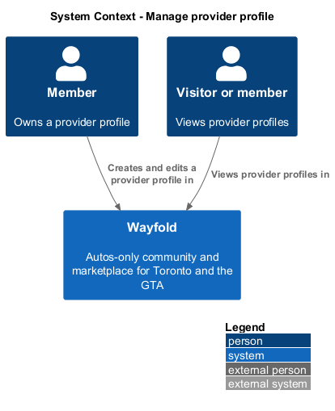
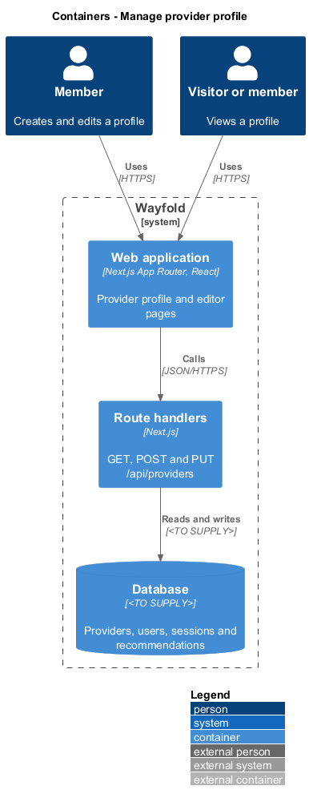
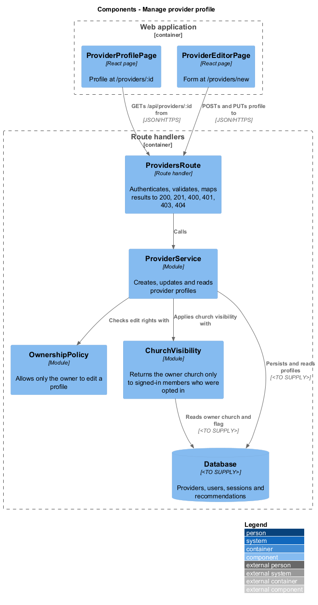
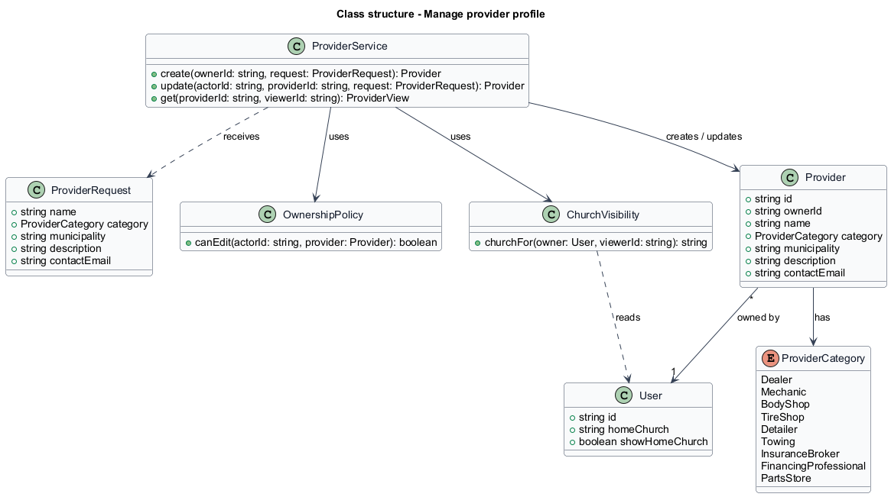
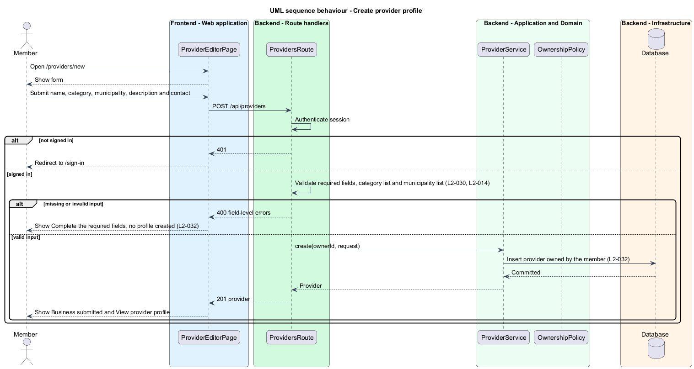
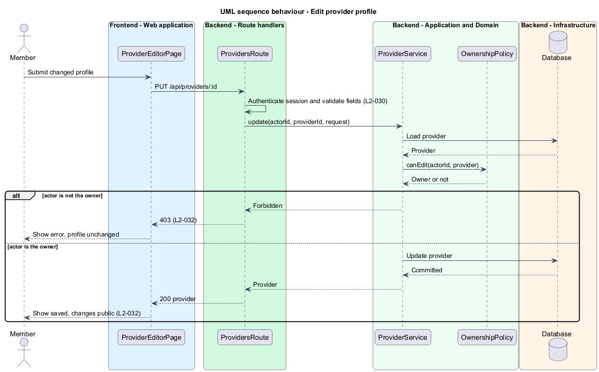
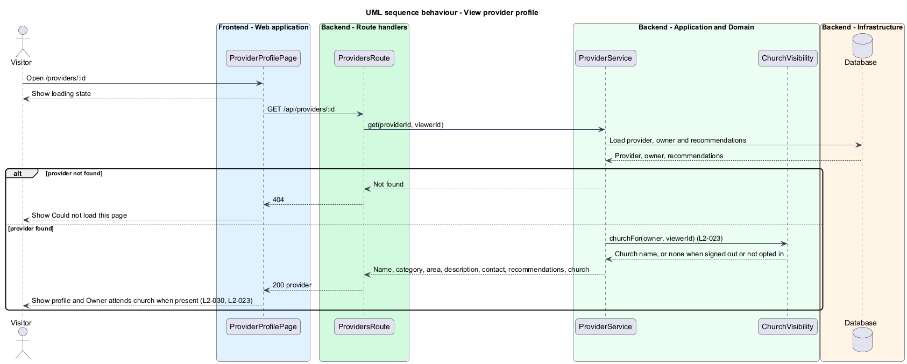

# Manage provider profile

## Overview

Wayfold is a responsive web application that is a micro-community for people in Toronto and the Greater Toronto Area who buy, sell and look after cars. Anyone in the GTA can join, and members may optionally show a home church as a trust signal. A *provider* is a business or professional in the auto industry with a public profile. A *provider profile* is that public page, owned by one member. The nine *categories* are dealer, mechanic, body shop, tire shop, detailer, towing, insurance broker, financing professional and parts store.

This feature lets a signed-in member create a provider profile and edit it later, and lets any visitor view it. The profile shows the name, category, GTA area, description, contact information and written recommendations. When the owner has opted in to show a home church, a signed-in member also sees that the owner attends it. It sits in the `providers` subsystem. `provider-directory` links to these profiles, and `verify-financing-credential` extends them for financing professionals.

The feature protects two concerns. Only the owner can change a profile; any other member receives `403`. The owner church never reaches a signed-out visitor or an owner who has not opted in.

## Description

The feature is a vertical slice from the profile and editor pages to the database.

- **`ProviderProfilePage`** — React page at `/providers/:id`. It shows the name, the category and area line, the description, the owner church line such as Owner attends St. Paul's Anglican, the recommendation count with a Recommend button, a Call action for the contact, and member recommendations. It shows the states of the mock `provider`: default, dealer (adds inventory), financing (adds the Verified badge, owned by `verify-financing-credential`), loading, and error with Could not load this page and a Try again button. At a 360 px viewport all content and actions remain reachable without horizontal scrolling.
- **`ProviderEditorPage`** — React page at `/providers/new`, titled List your business. It renders the business name, the category, the GTA municipality, the description (What do you do?), the contact email and the financing credential field. It shows the states of the mock `provider-editor`: default; loading; submitting; invalid, with Complete the required fields and inline messages such as Enter a name; error; and success, with Business submitted and View provider profile. The route for editing an existing profile is `<TO SUPPLY>`; the mocks show only `/providers/new`.
- **`ProvidersRoute`** — route handlers for `GET /api/providers/:id`, `POST /api/providers` and `PUT /api/providers/:id`. They authenticate the session for writes, validate the fields, reject a category outside the nine or a municipality outside the defined list with `400`, and map results to `200`, `201`, `400`, `401`, `403` or `404`.
- **`ProviderService`** — module holding the application logic. It creates a `Provider` under the ownership of the member, updates it, and reads it with its recommendations.
- **`OwnershipPolicy`** — module that allows an edit only when the actor owns the `Provider`.
- **`ChurchVisibility`** — module that returns the owner's `homeChurch` only when the viewer is a signed-in member and the owner has `showHomeChurch` enabled. Otherwise the response omits the church.
- **`Provider`** — record with `id`, `ownerId`, `name`, `category`, `municipality`, `description` and `contactEmail`. A saved profile is public. Whether a profile has a draft state is `<TO SUPPLY>`.

The contact information fields are `<TO SUPPLY>`: the editor mock collects a contact email, while the profile mock shows a phone action. Recommendations are written by the recommendations feature and read here. The database technology and the auth library are `<TO SUPPLY>`.

## Requirements

| L2 ID | Refines (L1) | Requirement |
|-------|--------------|-------------|
| `L2-030` | `L1-012` | A provider profile shall show its category, GTA area, description, contact information and written recommendations. Categories shall be dealer, mechanic, body shop, tire shop, detailer, towing, insurance broker, financing professional or parts store. |
| `L2-032` | `L1-012` | A signed-in member shall create and manage a provider profile for their business. |
| `L2-023` | `L1-002` | An opted-in church affiliation shall appear with a private seller, recommendation author or provider owner only to signed-in members. |

Acceptance criteria from the specification for `L2-030`: a published provider page shows name, category, area, description, contact and recommendations. A category outside the list is rejected. At 360 px all content and actions remain reachable without horizontal scrolling.

Acceptance criteria from the specification for `L2-032`: a submitted name, category, municipality, description and contact create a profile owned by the member. Owner edits appear publicly. Another member who edits receives `403`. Missing required information shows inline errors and creates no profile.

Acceptance criteria from the specification for `L2-023` that this feature covers: a provider owner who opts in is stated as attending the church to signed-in members. A signed-out visitor, or an owner who has not opted in, receives no church affiliation.

## Diagrams

### System context

An owner manages a provider profile and any visitor views it. No external system takes part.

### Containers

The browser loads the profile and editor pages, which call the route handlers. The handlers read and write the database.

### Components

`ProvidersRoute` delegates to `ProviderService`, which uses `OwnershipPolicy` for edits and `ChurchVisibility` for reads.

### Class structure

`ProviderService` receives a `ProviderRequest`, creates or updates a `Provider` owned by a `User`, and asks `OwnershipPolicy` and `ChurchVisibility` for decisions.

### Behaviour - create provider profile

The route redirects a signed-out member to sign-in and rejects missing or invalid fields with inline errors. Otherwise the service creates the profile under the member (`L2-032`, `L2-030`).

### Behaviour - edit provider profile

The service loads the profile and asks `OwnershipPolicy`. A non-owner receives `403`. The owner's changes are saved and appear publicly (`L2-032`).

### Behaviour - view provider profile

The service loads the profile and recommendations. `ChurchVisibility` adds the owner church only for a signed-in viewer when the owner opted in (`L2-030`, `L2-023`).

