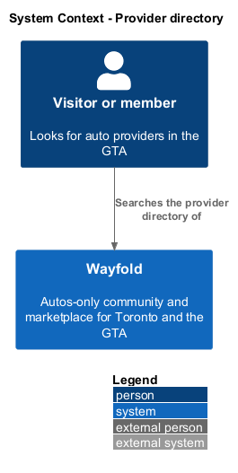
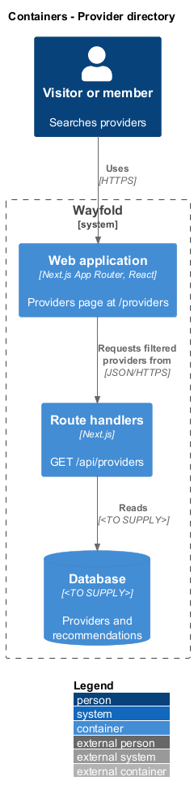
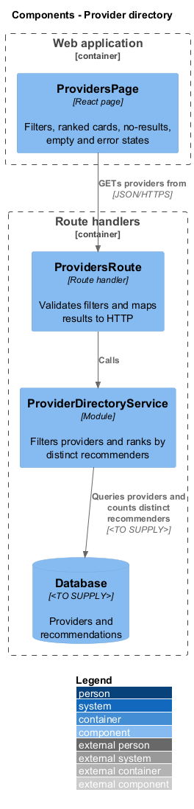
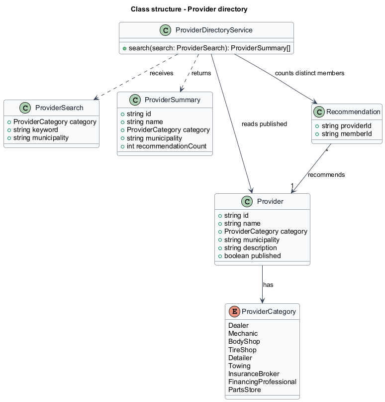
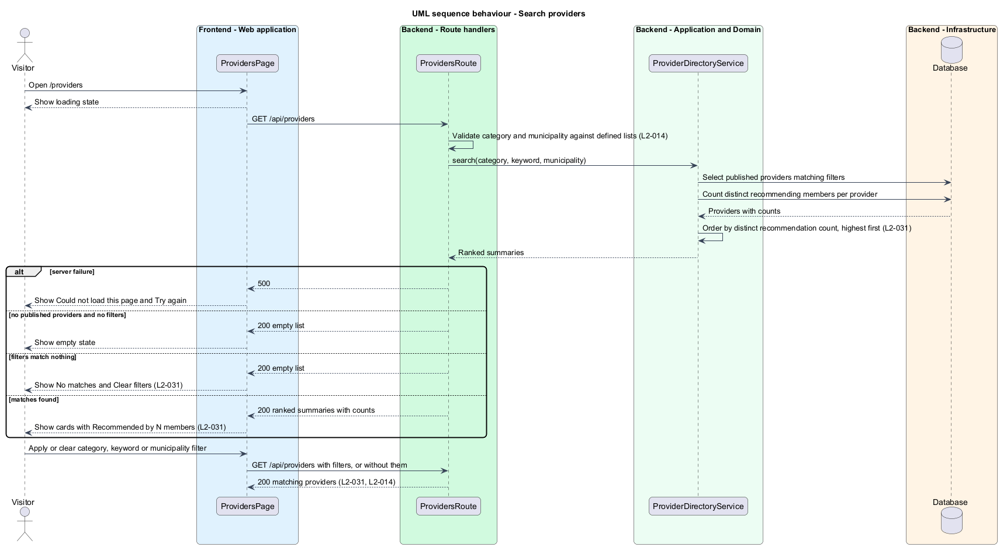

# Provider directory

## Overview

Wayfold is a responsive web application that is a micro-community for people in Toronto and the Greater Toronto Area who buy, sell and look after cars. Anyone in the GTA can join, and members may optionally show a home church as a trust signal. A *provider* is a business or professional in the auto industry with a public profile, in one of nine categories. A *recommendation* is a member's written endorsement of a provider. A *municipality* is one entry of the defined list of Toronto and GTA municipalities.

This feature lets any visitor, signed in or not, find providers by category, keyword and municipality. Results appear ordered by the number of distinct members who recommend each provider, highest first, with the count on each card. It sits in the `providers` subsystem. It reads the profiles that `manage-provider-profile` creates and the recommendations that members write.

The feature protects discovery quality in two ways. The ranking counts each member once per provider, so repeated recommendations do not raise a provider's position. Filters accept only values from the defined lists.

## Description

The feature is a vertical slice from the providers page to the database. The route is `/providers`.

- **`ProvidersPage`** — React page in the Next.js App Router. It renders a search box, a category filter (All, Dealers, Mechanics, Body shops, Tire shops, Detailers, Towing, Insurance, Financing, Parts), a GTA municipality filter (All of the GTA and the defined municipalities), a Search button, and a List your business link. It shows the states of the mock `providers`: default, a ranked list of cards such as Recommended by 28 members; loading; empty, with Nothing here yet when no provider is published; no-results, with No matches and a Clear filters button; and error, with Could not load this page and a Try again button.
- **`ProvidersRoute`** — route handler for `GET /api/providers`. It reads the `category`, `q` and `municipality` query parameters, rejects values outside the defined lists with `400`, calls the service, and returns the ranked summaries.
- **`ProviderDirectoryService`** — module holding the query logic. It selects published providers that match every supplied filter, counts distinct recommending members for each, and orders by that count, highest first.
- **`ProviderSearch`**, **`ProviderSummary`** — request and result shapes. A summary carries `id`, `name`, `category`, `municipality` and `recommendationCount`.
- **`Provider`**, **`Recommendation`** — records read by the service.

The fields that the keyword matches, the order among providers with equal counts, and the page size are `<TO SUPPLY>`. The municipality list is `<TO SUPPLY>`. The database technology is `<TO SUPPLY>`.

## Requirements

| L2 ID | Refines (L1) | Requirement |
|-------|--------------|-------------|
| `L2-031` | `L1-012` | Visitors shall find providers by category, keyword and GTA municipality, ordered by distinct member recommendation count. |
| `L2-014` | `L1-005` | Listings, providers and recommended products shall carry a location chosen from a defined list of Toronto and GTA municipalities, and users shall filter each directory by it. |

Acceptance criteria from the specification for `L2-031`: the most recommended providers appear first with their counts. A category, keyword or municipality filter shows only matching providers. No matches produce a no-results message and a way to clear filters.

Acceptance criteria from the specification for `L2-014` that this feature covers: a visitor filtering the provider directory by one municipality sees only results in it. A location outside the list submitted directly to the API is rejected.

## Diagrams

### System context

A visitor or member searches the provider directory in Wayfold. No external system takes part.

### Containers

The browser loads the providers page, which calls the route handler. The handler reads the database.

### Components

`ProvidersRoute` validates the filters and delegates to `ProviderDirectoryService`, which queries the database.

### Class structure

`ProviderDirectoryService` receives a `ProviderSearch`, reads published `Provider` records, counts distinct members of `Recommendation` records, and returns `ProviderSummary` values.

### Behaviour - search providers

The route rejects values outside the defined lists. The service filters, counts distinct recommenders and orders the result. The page shows the ranked cards, or the empty, no-results or error state (`L2-031`, `L2-014`).

