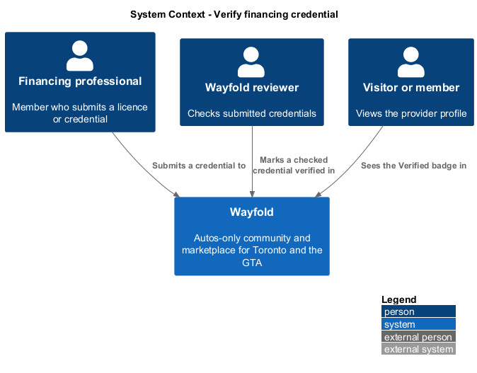
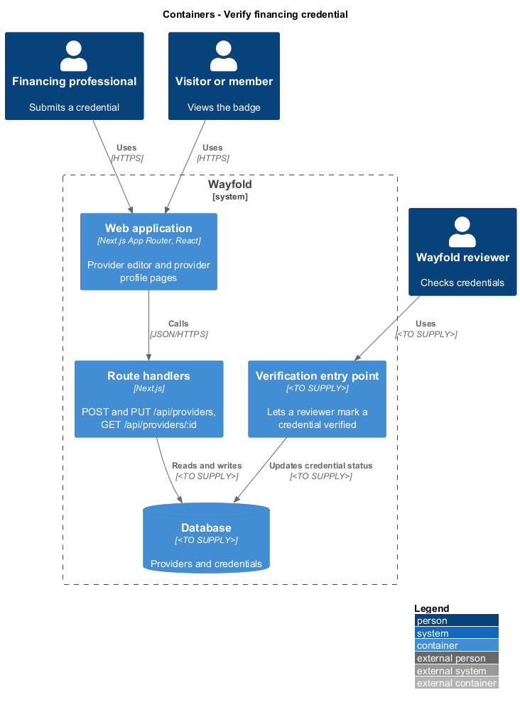
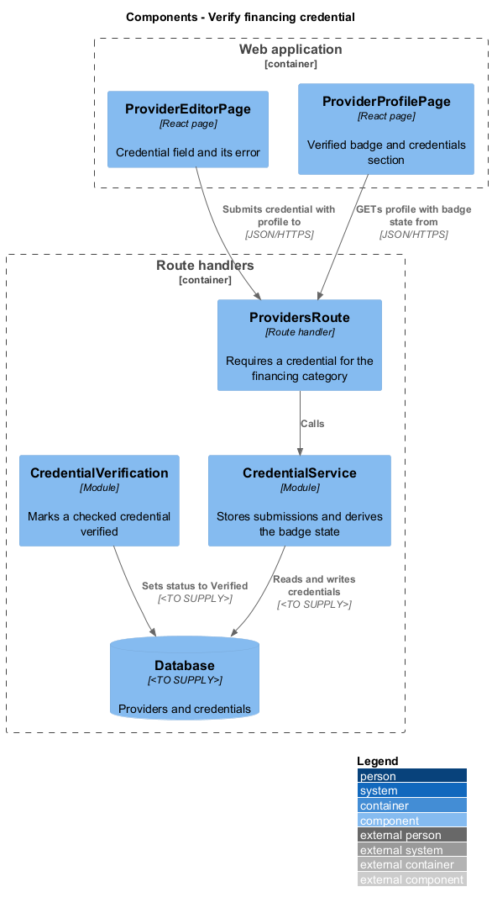
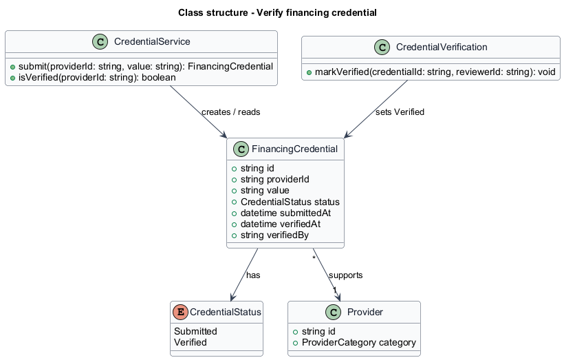
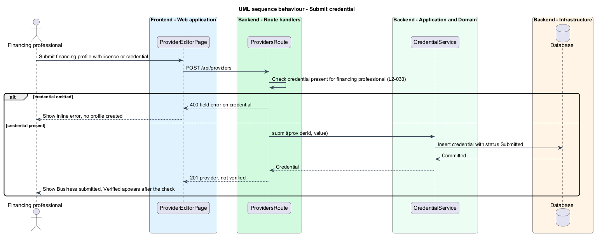
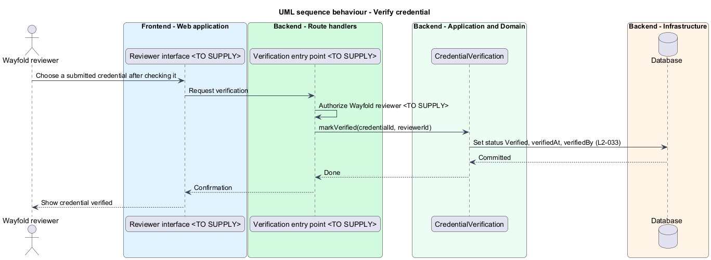
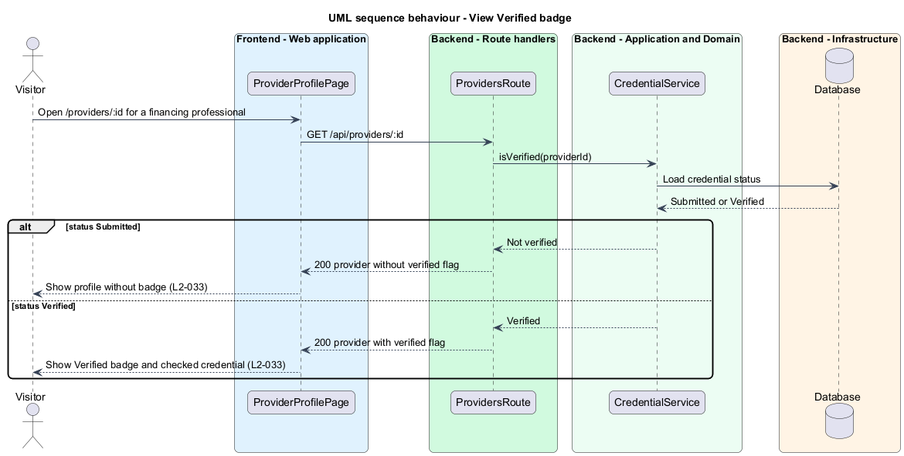

# Verify financing credential

## Overview

Wayfold is a responsive web application that is a micro-community for people in Toronto and the Greater Toronto Area who buy, sell and look after cars. Anyone in the GTA can join, and members may optionally show a home church as a trust signal. A *financing professional* is a provider in the financing professional category who advises members on vehicle prices and financing offers. A *credential* is a licence or similar proof of authority, submitted as part of the provider profile. A *Verified badge* is the mark on a provider profile that shows Wayfold has checked the credential.

This feature makes the badge trustworthy. A financing professional shall submit a credential when creating the profile. The badge appears only after Wayfold checks the credential and marks it verified. A submitted but unchecked credential produces no badge. The feature sits in the `providers` subsystem and extends `manage-provider-profile`, which owns the editor and the profile page.

The badge matters because verified financing professionals answer members' public questions about whether a price or financing offer is a good deal. Members read the badge as evidence that the answerer is licensed.

## Description

The feature is a slice that spans the provider editor, the provider profile and a review step.

- **`ProviderEditorPage`** — the page at `/providers/new` from `manage-provider-profile`. Its field Financing licence or credential (financing professionals) is required when the category is financing professional. An omitted credential shows an inline error and the form rejects submission. After a valid submit, the success state states that financing professionals appear as Verified after Wayfold checks the licence.
- **`ProviderProfilePage`** — the page at `/providers/:id`. In the financing state of the mock `provider`, it shows the Verified badge beside the name and a Credentials and answers section with text such as FSRA licence checked by Wayfold. Without verification, the page omits the badge. The text shown for an unchecked credential is `<TO SUPPLY>`.
- **`ProvidersRoute`** — the route handlers of `manage-provider-profile`. For the financing professional category they reject a missing credential with `400` and return a `verified` flag derived from the credential status.
- **`CredentialService`** — module that stores a submitted credential with status `Submitted` and reports whether a provider is verified.
- **`CredentialVerification`** — module that sets a credential to `Verified` and records `verifiedAt` and `verifiedBy`. It runs only through a reviewer entry point.
- **`FinancingCredential`** — record with `id`, `providerId`, `value`, `status`, `submittedAt`, `verifiedAt` and `verifiedBy`.

The remaining details are undecided and marked `<TO SUPPLY>`: the form of a credential (text, number or uploaded file) and its storage; the reviewer entry point, its interface and the Wayfold reviewer role; the checks a reviewer performs and the accepted licence types; whether editing a verified credential resets its status to `Submitted`; and any notice sent to the financing professional on verification. The mocks and requirements do not define a reviewer screen.

## Requirements

| L2 ID | Refines (L1) | Requirement |
|-------|--------------|-------------|
| `L2-033` | `L1-012` | Financing professionals shall submit a licence or credential. A Verified badge shall appear only after Wayfold checks it. |

Acceptance criteria from the specification: a financing professional who omits a credential is rejected by the form. A submitted but unchecked credential produces no Verified badge. A credential marked verified by Wayfold produces the Verified badge.

## Diagrams

### System context

A financing professional submits a credential, a Wayfold reviewer marks it verified, and any visitor sees the badge. No external system takes part.

### Containers

The web application and route handlers carry the submission and the badge. A verification entry point, whose technology is undecided, updates the credential in the database.

### Components

`ProvidersRoute` calls `CredentialService` for submissions and badge state. `CredentialVerification` changes the status in the database.

### Class structure

A `FinancingCredential` supports one `Provider` and has a `CredentialStatus`. `CredentialService` creates and reads credentials. `CredentialVerification` sets the status to `Verified`.

### Behaviour - submit credential

The route rejects a financing profile without a credential. Otherwise the service stores the credential as `Submitted` and the profile shows no badge (`L2-033`).

### Behaviour - verify credential

A Wayfold reviewer marks a checked credential verified through an entry point that is `<TO SUPPLY>`. The module records who verified it and when (`L2-033`).

### Behaviour - view Verified badge

The profile route returns the `verified` flag only when the credential status is `Verified`. The page shows the badge only then (`L2-033`).

