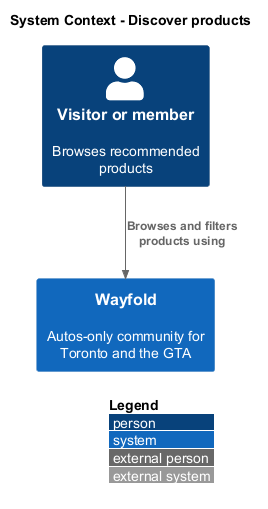
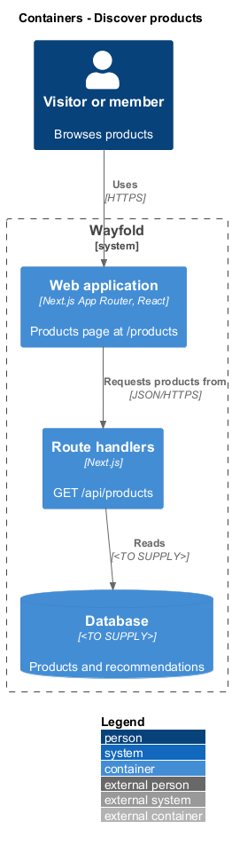
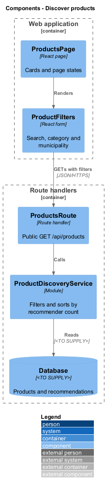
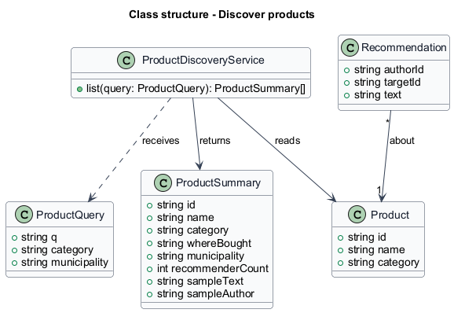
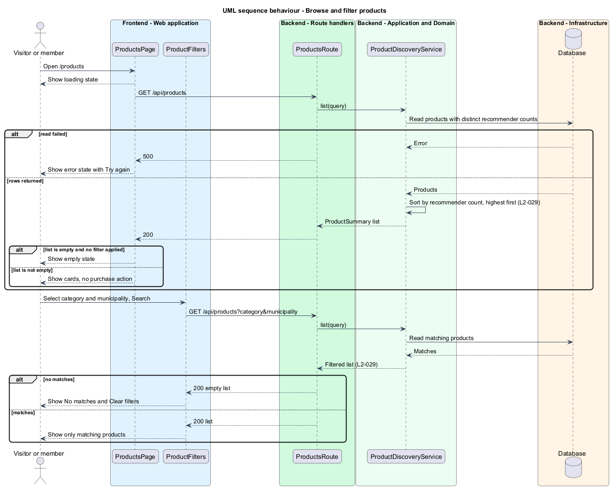

# Discover products

## Overview

Wayfold is a responsive web application that is a micro-community for people in Toronto and the Greater Toronto Area (GTA) who buy, sell and look after cars. A *product* is an auto item, such as a set of winter tires or a dash cam, that members recommend. A *municipality* is a GTA city or district, such as Toronto or Brampton. Products are not sold on Wayfold, so the page offers no purchase or checkout action.

This feature lets any visitor browse the recommended products at `/products`. The list is sorted by the number of recommending members, and a visitor can narrow it by category and municipality.

The feature sits in the `recommendations` subsystem. It reads the recommendations and counts that the `recommend` feature creates. The page is public, so a visitor sees products without an account and without church affiliation (`L2-039`).

## Description

The feature is a vertical slice from the products page to the database.

- **`ProductsPage`** - React page at `/products`. It renders the heading "Products" with the text "Members recommend what they use. Products are not sold on Wayfold.", the filter bar, and the product cards. It shows the loading, empty ("Nothing here yet"), error ("Could not load this page" with Try again) and no-results states.
- **`ProductFilters`** - React form with Search, Category and GTA municipality, and a Search action. The mock lists the categories All, Winter tires, Interior, Dash cams and Detailing, and the municipalities All of the GTA, Toronto, Etobicoke, Scarborough, Brampton and Mississauga. The complete lists are `<TO SUPPLY>`.
- **`ProductCard`** - React component with the product name, category, purchase source, municipality, "Recommended by N members" and one sample recommendation with its author. It has no price, cart or buy action. A signed-out visitor sees "Sign in to recommend this product".
- **`NoResults`** - React component with "No matches", the text "Try another category or search term." and a Clear filters action.
- **`ProductsRoute`** - route handler for `GET /api/products` with query parameters `q`, `category` and `municipality`. It is public.
- **`ProductDiscoveryService`** - module that applies the filters and sorts by the count of distinct recommending members, highest first. The tie-break order is `<TO SUPPLY>`.
- **`Product`** and **`Recommendation`** - records defined in the `recommend` design.

The layout fits a 360 px viewport without horizontal scrolling (`L2-027`). The municipality of a product comes from `<TO SUPPLY>`; the four fields in `L2-027` do not include a municipality. Page size and pagination are `<TO SUPPLY>`. The database technology is `<TO SUPPLY>`.

## Requirements

| L2 ID | Refines (L1) | Requirement |
|-------|--------------|-------------|
| `L2-029` | `L1-011` | Visitors shall browse recommended auto products by category and GTA municipality, sorted by number of recommending members. |

Acceptance criteria from the specification: products with more recommending members appear first when the directory opens. A selected category and municipality show only matching products. When no product matches, a no-results message and a way to clear filters appear.

The design also applies the product display criterion of `L2-027` (360 px fit and no purchase action) and the "Recommended by N members" rule of `L2-028` to the cards.

## Diagrams

### System context

A visitor or member browses recommended products through Wayfold. No external system takes part.

### Containers

The products page in the web application calls the public products route handler, which reads the database.

### Components

`ProductFilters` drives `ProductsRoute`, which delegates to `ProductDiscoveryService`.

### Class structure

`ProductDiscoveryService` takes a `ProductQuery` and returns `ProductSummary` values sorted by `recommenderCount`.

### Behaviour - browse and filter products

The route filters by category and municipality and sorts by recommender count. The page shows the loading, error, empty and no-results states (`L2-029`).

