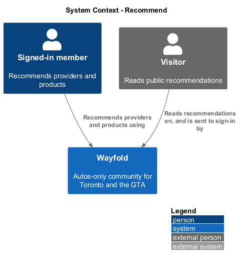
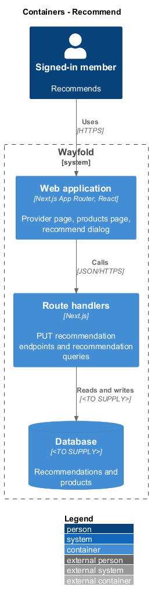
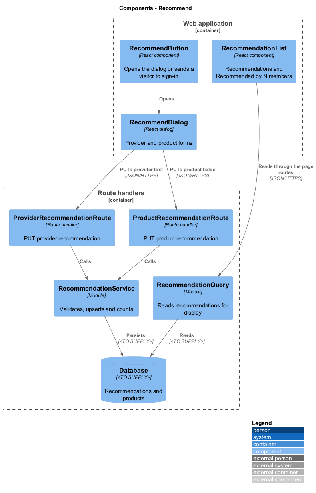
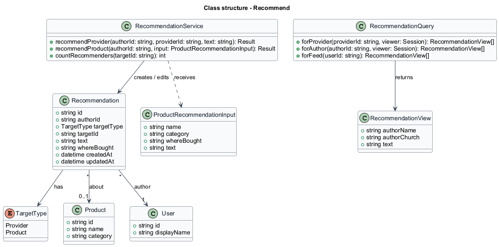
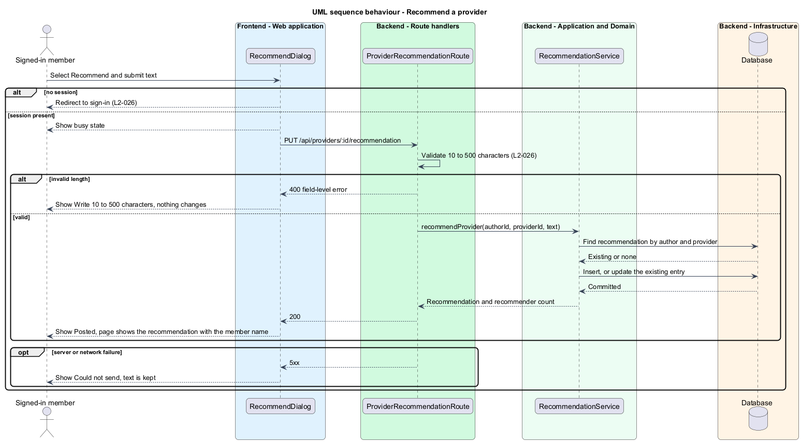
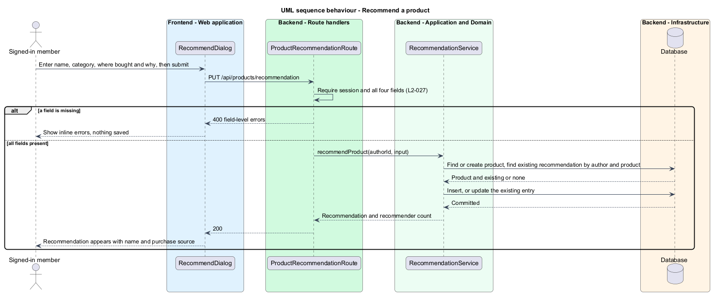
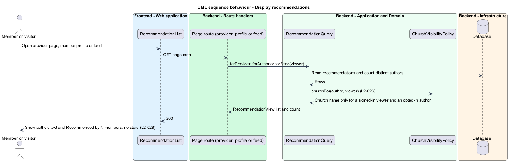

# Recommend

## Overview

Wayfold is a responsive web application that is a micro-community for people in Toronto and the Greater Toronto Area (GTA) who buy, sell and look after cars. A *provider* is an auto-industry business with a profile, such as a mechanic, dealer or detailer. A *recommendation* is a short written endorsement of a provider or an auto product by a member. A *product* is an auto item, such as a set of winter tires, that members recommend. Products are not sold on Wayfold.

This feature lets a signed-in member recommend a provider or a product. A member holds one recommendation per provider or product, and submitting another edits the first. The feature also displays recommendations on the provider page, the author's member profile and the feed, and shows "Recommended by N members" without star ratings.

The feature sits in the `recommendations` subsystem. It feeds the provider profile, the member profile and the feed, and it supplies the counts that `discover-products` sorts by.

## Description

The feature is a vertical slice from the recommend dialog to the database.

- **`RecommendDialog`** - React dialog on `/providers/:id` and `/products`. In provider mode it shows "Recommend Name" with one field, "Your recommendation (10 to 500 characters)". In product mode it shows "Recommend a product" with Product name, Category, Where did you buy it? and Why do you recommend it?. The mock shows provider states default, busy ("Sending..."), invalid ("Write 10 to 500 characters"), failed ("Could not send - Try again. Your text is still here.") and success ("Posted - Your message is available now." with Done), and one product state.
- **`RecommendButton`** - React component that opens the dialog for a signed-in member and sends a visitor to sign-in (`L2-026`).
- **`ProviderRecommendationRoute`** - route handler for `PUT /api/providers/:id/recommendation`. It requires a session and creates or replaces the member's recommendation.
- **`ProductRecommendationRoute`** - route handler for `PUT /api/products/recommendation`. It requires a session and the four product fields.
- **`RecommendationService`** - module that validates text, resolves the target, and creates or edits the single recommendation for the member and target. It counts distinct recommending members.
- **`RecommendationQuery`** - module that returns recommendations for a provider page, an author profile and the feed. It attaches the author name and applies `ChurchVisibilityPolicy` for the author's church tag (`L2-023`).
- **`RecommendationList`** and **`RecommendedByCount`** - React components that render recommendation text with the author, and the text "Recommended by N members". Neither renders a star rating (`L2-028`).
- **`Recommendation`** - record with `id`, `authorId`, `targetType` (provider or product), `targetId`, `text`, `whereBought`, `createdAt` and `updatedAt`. The pair (`authorId`, `targetId`) is unique.
- **`Product`** - record with `id`, `name` and `category`. The rule that matches a submitted product name to an existing `Product` is `<TO SUPPLY>`.

The `RecommendationQuery` output reaches the feed through `FeedService` of the `posts-and-feed` design, and reaches the profile through `ProfileService` of the `view-member-profile` design. The community toast "Recommendation posted - Your recommendation is now visible to members." confirms a save.

The database technology and the auth library are `<TO SUPPLY>`.

## Requirements

| L2 ID | Refines (L1) | Requirement |
|-------|--------------|-------------|
| `L2-026` | `L1-011` | A signed-in member shall write one recommendation of 10 to 500 characters per provider; submitting another edits the existing recommendation. |
| `L2-027` | `L1-011` | A signed-in member shall recommend an auto product by name, category, where they bought it and why they use it. Products shall not be sold on Wayfold. |
| `L2-028` | `L1-011` | Written recommendations shall appear on the author's member profile, the provider page and the feed; provider and product pages shall show Recommended by N members without star ratings. |

Acceptance criteria from the specification: a recommendation of 10 to 500 characters is shown with the member's name. A revision changes the existing entry and the count stays the same. Fewer than 10 or more than 500 characters produces an inline error and nothing changes. A visitor who selects Recommend is sent to sign-in (`L2-026`). A product recommendation with all four fields appears with the member's name and purchase source. A second recommendation of the same product edits the first. A missing field produces an inline error and nothing is saved. A product page at 360 px fits without horizontal scrolling and offers no purchase or checkout action (`L2-027`). A published provider recommendation appears on the author profile, the provider page and the signed-in feed. Three distinct recommending members produce "Recommended by 3 members". No surface shows a star rating (`L2-028`).

## Diagrams

### System context

A signed-in member recommends a provider or product. A visitor reads public recommendations and is sent to sign-in to recommend. No external system takes part.

### Containers

The provider and products pages in the web application call the recommendation route handlers, which persist to the database.

### Components

The dialog calls the two routes. Both delegate to `RecommendationService`. `RecommendationQuery` serves the three display surfaces.

### Class structure

A `Recommendation` links an author to a provider or a product. `RecommendationService` enforces one recommendation per author and target.

### Behaviour - recommend a provider

The route validates 10 to 500 characters and the service creates or edits the single recommendation (`L2-026`).

### Behaviour - recommend a product

The route requires all four fields. The service edits the existing recommendation of the same product (`L2-027`).

### Behaviour - display recommendations

The query returns recommendations and the distinct member count for a provider page, a profile and the feed. The church tag appears only to signed-in members (`L2-028`, `L2-023`).

